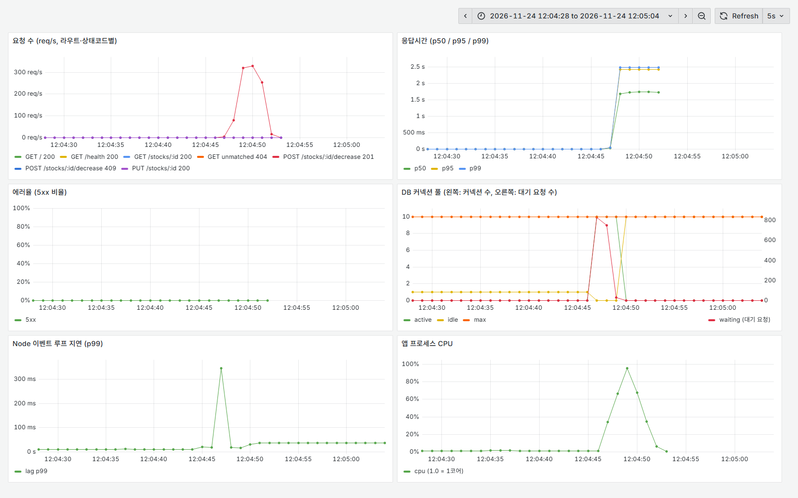

# 재고 차감 동시성 벤치마크

재고 100개에 차감 요청 1000건을 동시에 보내, 동시성 제어 전략별로 정합성(오버셀링)과 성능을 비교한다.

## 시나리오

- 스크립트: `k6/stock-decrease.js` (`pnpm k6:stock`)
- executor: `shared-iterations`, VU 1000명, 반복 1000회 (VU당 1건)
- 요청: `POST /stocks/1/decrease` `{ "quantity": 1 }`
- 초기 재고 100 (setup에서 `PUT /stocks/1`로 매 실행마다 초기화)
- 판정: `sold > 100`이면 오버셀링 (threshold `sold: count<=100`)
- 결과 JSON: `k6/results/<strategy>-<timestamp>.json`

## 모니터링

부하 테스트 중 병목을 보려면 Prometheus + Grafana를 함께 띄운다.

```bash
pnpm dev          # app, postgres, redis
pnpm monitoring   # prometheus(:9090), grafana(:3001)
pnpm k6:stock
```

- Grafana: http://localhost:3001 (로그인 없음, 홈이 `dips app` 대시보드)
- 앱 메트릭: http://localhost:3000/metrics (Prometheus가 1초마다 수집)

| 패널 | 메트릭 | 볼 것 |
|---|---|---|
| 요청 수 | `http_request_duration_seconds_count` | 라우트·상태코드별 req/s |
| 응답시간 | `http_request_duration_seconds_bucket` | p50/p95/p99 |
| 에러율 | 위 count 중 `status_code=~"5.."` 비율 | 409(재고 부족)는 정상 거절이라 제외 |
| DB 커넥션 풀 | `db_pool_connections{state}`, `db_pool_waiting_requests`, `db_pool_max_connections` | active가 max에 붙고 waiting이 쌓이면 풀이 병목 |
| 이벤트 루프 지연 / CPU | `nodejs_eventloop_lag_p99_seconds`, `process_cpu_seconds_total` | 앱 프로세스 자체가 포화인지 |

모니터링 컨테이너도 같은 Docker VM 자원을 쓰므로, 수치 비교용 측정은 기존처럼 모니터링 없이 돌리고 병목 관찰용 실행과 구분한다.

## 실행 환경

| 항목 | 값 |
|---|---|
| CPU | AMD Ryzen 5 4500U (6코어 6스레드) |
| 메모리 | 11.4 GB |
| OS | Windows 11 Home |
| Docker | Docker Desktop 29.9.3 (WSL2, 커널 6.6.87.2) |
| Docker VM 자원 | vCPU 4개, 메모리 5.8 GB |
| 컨테이너 자원 제한 | 없음 (app, postgres, redis, k6가 VM 자원을 공유) |
| 앱 | NestJS 12, Node 26.13.1, `pnpm start:dev` (watch 모드) |
| DB | PostgreSQL 18.4 (alpine), `max_connections` 100 |
| ORM / 드라이버 | Prisma 7.10.1 + `@prisma/adapter-pg` (pg 8.23.1) |
| DB 커넥션 풀 | **10** (pg-pool 기본값 `max: 10`, 별도 설정 없음) |
| k6 | grafana/k6 1.3.0 (같은 Docker 네트워크에서 `http://app:3000`으로 호출) |

**주의**
- 부하 발생기(k6)와 앱, DB가 같은 VM에서 CPU를 나눠 쓴다. 절대 수치보다는 전략 간 상대 비교용으로 본다.
- 앱이 dev 모드(`start:dev`)로 실행된다. 프로덕션 빌드보다 느릴 수 있다.

## 결과: naive (락 없음)

조회 → JS에서 차감 → 저장 (`src/stock/stock.service.ts`의 `decrease`)

| 회차 | 결과 파일 | 판매(sold) | 거절(rejected) | 오버셀링 | TPS | p95 (ms) | 실패율 |
|---|---|---|---|---|---|---|---|
| 1 | `naive-1795485730558.json` | 1000 | 0 | 900 | 204.5 | 3336.9 | 0 |
| 2 | `naive-1795485795635.json` | 1000 | 0 | 900 | 300.7 | 2712.5 | 0 |
| 3 | `naive-1795485830638.json` | 1000 | 0 | 900 | 304.9 | 2607.0 | 0 |
| **평균** | | **1000** | **0** | **900** | **270.0** | **2885.5** | **0** |

- 측정일: 2026-11-24, 커밋 `7fbb52e` (`feat/stock-no-lock`)

<details>
<summary>원본 JSON</summary>

`naive-1795485730558.json`
```json
{
  "strategy": "naive",
  "initial": 100,
  "requests": 1000,
  "sold": 1000,
  "rejected": 0,
  "oversold": 900,
  "tps": 204.534048195427,
  "p95_ms": 3336.8788901499997,
  "failed_rate": 0
}
```

`naive-1795485795635.json`
```json
{
  "strategy": "naive",
  "initial": 100,
  "requests": 1000,
  "sold": 1000,
  "rejected": 0,
  "oversold": 900,
  "tps": 300.705273969505,
  "p95_ms": 2712.4939327,
  "failed_rate": 0
}
```

`naive-1795485830638.json`
```json
{
  "strategy": "naive",
  "initial": 100,
  "requests": 1000,
  "sold": 1000,
  "rejected": 0,
  "oversold": 900,
  "tps": 304.8969081630825,
  "p95_ms": 2606.989388,
  "failed_rate": 0
}
```

</details>

### 해석

- 3회 모두 1000건이 전부 판매되어 **오버셀링 900건**이 났다. 409(재고 부족)는 한 건도 없었다.
- 여러 요청이 같은 재고 값을 읽고 덮어써서(lost update) 재고가 0까지 내려가지 않는다. 그래서 거절이 생기지 않는다.
  - 최종 재고만 보면 오버셀링을 놓친다. 판매 건수(`sold`)로 판정해야 한다.
- p95 약 2.9초의 대부분은 커넥션 풀(10개) 대기 시간으로 보인다. 요청 1000건이 커넥션 10개를 기다리며 줄을 선다.
- 1회차 TPS(204.5)가 2·3회차(약 300)보다 낮다. 첫 실행의 워밍업 영향으로 추정한다.

## 관찰: naive 실행 중 DB 커넥션 풀

모니터링을 켠 상태로 naive 시나리오를 다시 돌려 커넥션 풀 상태를 확인했다.

- 측정일: 2026-11-24, 브랜치 `feat/metrics`
- 수집 간격 1초. 메트릭은 1초 단위 샘플이라 순간 최댓값은 놓칠 수 있다.

| 회차 | 모니터링 | TPS | p95 (ms) | waiting 최대 | 앱 CPU 사용량(초) |
|---|---|---|---|---|---|
| mon1 | 켬 | 49.3 | 19568.0 | 727 | 약 25 |
| mon2 | 켬 | 353.9 | 2436.1 | 832 | 약 3.0 |
| nomon1 | 끔 | 393.8 | 2256.8 | - | 약 3.7 (nomon1·2 평균) |
| nomon2 | 끔 | 382.4 | 2240.8 | - | 약 3.7 (nomon1·2 평균) |
| mon3 | 켬 (직전 재시작) | 29.0 | 26184.4 | 937 | 약 25.6 |

- 모든 회차에서 오버셀링 900건으로 정합성 결과는 이전과 같다.
- 앱 CPU 사용량은 `process_cpu_seconds_total`의 회차 전후 차이다. 요청 1000건을 처리하는 데 쓴 CPU 시간이다.

### 일반적인 회차 (mon2)



- 부하가 들어오자마자 `active`가 `max`(10)에 붙고, `waiting`이 **832**까지 치솟는다.
  - 요청 1000건 중 10건만 DB 커넥션을 잡고, 나머지 800여 건은 풀 앞에서 줄을 선다.
- 앱 CPU는 1코어의 약 95%까지 오르지만 짧게 끝나고, 이벤트 루프 지연도 한 번 튀었다가(약 350ms) 바로 내려온다.
- 응답시간 p50 약 1.7초, p95 약 2.4초.
  - 요청 하나의 DB 작업(SELECT + UPDATE)은 짧으므로, 대부분은 커넥션을 기다린 시간이다.
- **결론: 이 시나리오의 1차 병목은 DB 커넥션 풀(10개)이다.** 앞에서 "p95의 대부분은 커넥션 풀 대기로 보인다"고 추정한 것을 메트릭으로 확인했다.
  - 단, 풀을 키우는 것은 지연을 줄일 뿐 오버셀링을 막지 못한다. 정합성 문제는 락/원자적 갱신으로 해결해야 한다.

### 느린 회차 (mon3)


5회 중 2회(mon1, mon3)는 TPS가 30~50으로 평소의 약 1/8이었다. 이때의 관찰:

- 풀은 똑같이 포화된다 (`active` 10, `waiting` 최대 937). 차이는 대기가 **약 30초** 지속된다는 점이다.
- 12:05:14~12:05:38 구간이 비어 있는 것은 Prometheus가 `/metrics` 수집에 실패했기 때문이다 (`up` = 0).
  - 수집 타임아웃은 수집 간격과 같은 1초다. 앱이 1초 안에 `/metrics`에 응답하지 못할 만큼 이벤트 루프가 막혀 있었다 (직전 이벤트 루프 지연 p99 약 660ms).
- 같은 요청 1000건에 앱 CPU를 약 25초 썼다. 빠른 회차(약 3초)의 **7~8배**다.
  - VM의 다른 컨테이너가 CPU를 빼앗아 느려진 것이 아니라, 앱 프로세스가 요청당 더 많은 일을 했다.
- 응답시간 그래프가 10초에서 평평한 것은 히스토그램 최대 버킷이 10초라서다. 실제 p95는 26초였다.
- CPU 그래프의 200%대 값은 수집 공백 직후 `rate()`가 계산한 값이라 실제 순간값과 다르다. 공백 구간 평균은 약 1코어다.

**원인은 아직 모른다.** 확인한 사실과 배제된 것:

- 모니터링을 켜기만 한다고 느려지지는 않는다 (mon2는 모니터링을 켜고도 빨랐다).
- 느린 두 회차 모두 모니터링이 켜져 있었다. mon3는 Prometheus·Grafana를 재시작한 직후였다. 모니터링을 끈 2회는 모두 빨랐지만 표본이 적어 관련 여부를 단정할 수 없다.
- 다음 단계: 느린 회차를 재현해서 앱 CPU 프로파일(`node --cpu-prof`)을 떠 본다. 원인을 찾기 전까지 전략 비교용 수치 측정은 모니터링을 끄고 한다.
