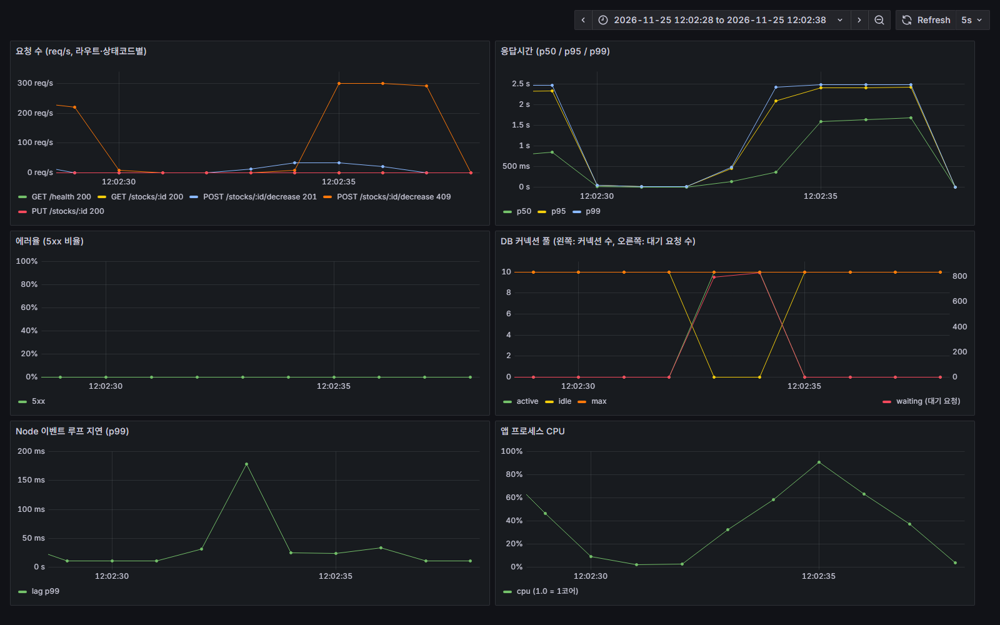

# 재고 차감 동시성 벤치마크

재고 100개에 차감 요청 1000건을 동시에 보내, 동시성 제어 전략별로 정합성(오버셀링)과 성능을 비교한다.

## 요약

풀 10, 5회 중앙값, 같은 커밋(`bdf4b91`) 기준. 근거는 [결과](#결과-다섯-전략-재측정--redis-lua-같은-커밋)와 [관찰](#관찰-redis-lua-대기-지점)에 있다. 이전 커밋 기준 수치는 [`c9ffd3a` 결과](#결과-네-전략-재측정--optimistic-lock-같은-커밋), [`56832ff` 결과](#결과-세-전략-재측정--pessimistic-lock-같은-커밋)에 있다.

| 전략 | 정합성 | TPS | p95 (ms) | 실패율 | 주요 대기 지점 |
|---|---|---|---|---|---|
| naive | 오버셀링 900 | 372.1 | 2310 | 0 | 행 락 (`Lock/transactionid`)\* |
| atomic-update | 정상 | 500.5 | 1660 | 0 | 판매 구간의 행 락뿐\* |
| pessimistic-lock | 정상 | 438.6 | 1942 | 0 | 행 락 (`Lock/tuple`). 풀을 키워도 개선 없음\* |
| optimistic-lock (재시도 상한 10, 기본값) | 오버셀링 없음. 판매 31, 소진(503) 969 | 72.7 | 13394 | 0.967 | 앱 쪽 (풀 커넥션은 모두 사용 중인데 DB는 대부분 유휴)\* |
| optimistic-lock (재시도 상한 100)† | 정상 | 21.4 | 46448 | 0 | 위와 같음 |
| redis-lua (반영 주기 100ms, 기본값) | 정상. DB는 Redis가 0이 된 뒤 중앙값 322ms에 0 | 679.7 | 745 | 0 | DB 대기 없음 (관찰 샘플에 실행 중 커넥션 0) |

\* 대기 지점은 이전 커밋에서 관찰한 결과다(naive·atomic-update·pessimistic-lock은 `56832ff`, optimistic-lock은 `c9ffd3a`). 이번 커밋에서는 redis-lua만 관찰했다.
† 상한 100은 이번에 다시 재지 않았다. `c9ffd3a` 수치다.

같은 행에 대한 경쟁에서는 락을 잡는 쓰기의 수가 처리량을 좌우하고, 커넥션 풀을 키워도 직렬화는 풀리지 않는다.

- 즉시 재시도하는 optimistic-lock은 이 시나리오(같은 행에 1000건 동시)에서 가장 나쁘다. 상한이 10 이하면 대부분 503으로 끝나 재고가 남고, 상한을 50 이상으로 올리면 재고는 다 팔리지만 다른 전략보다 약 20배 느리다. 재시도만큼 앱 CPU도 늘어서 상한 10에서 다른 전략의 약 5배, 50·100에서 약 20배다.
- `c9ffd3a` 세션의 TPS는 `56832ff` 세션보다 전반적으로 낮고, atomic-update(332~532)와 pessimistic-lock(359~474)의 범위가 겹친다. 중앙값 순서(atomic-update > pessimistic-lock > naive)는 같다.
- redis-lua는 이번 세션에서 TPS 중앙값이 가장 높고 p95가 가장 낮다. 다만 회차 간 편차가 크다(TPS 579~1382). 차감 경로에서 DB를 쓰지 않으므로 정합성의 기준은 Redis이고, DB는 플러시로 뒤따라간다.
- pessimistic-lock의 실패율 0은 트랜잭션 옵션을 `maxWait`·`timeout` 30초로 늘린 결과다. 기본값(2초/5초)에서는 5회 중 3회에서 500이 났다 ([실험](#실험-pessimistic-lock-기본-트랜잭션-옵션)).

## 시나리오

- 스크립트: `k6/stock-decrease.js` (`pnpm k6:stock`)
- executor: `shared-iterations`, VU 1000명, 반복 1000회 (VU당 1건)
- 요청: `POST /stocks/1/decrease` `{ "quantity": 1 }`
- 초기 재고 100 (setup에서 `PUT /stocks/1`로 매 실행마다 초기화)
- 판정: `sold > 100`이면 오버셀링 (threshold `sold: count<=100`)
- 결과 JSON: `k6/results/<strategy>-<timestamp>.json`

## 전략 전환

엔드포인트는 그대로 두고, 앱 환경변수 `STOCK_STRATEGY`로 차감 전략을 고른다 (`src/stock/strategies/`, 기본값 `naive`).

| 값 | 전략 |
|---|---|
| `naive` | 조회 → JS에서 차감 → 저장 (락 없음) |
| `atomic-update` | `UPDATE ... SET quantity = quantity - n WHERE id = ? AND quantity >= n` 한 문장 |
| `pessimistic-lock` | 트랜잭션 + `SELECT ... FOR UPDATE`로 행을 잠근 뒤 확인·차감 |
| `optimistic-lock` | version 컬럼 비교 후 갱신, 충돌 시 즉시 재시도, 상한 초과 시 503 |
| `redis-lua` | Lua로 재고 확인·차감을 원자적으로 처리하고, DB에는 인터벌마다 현재값을 덮어써 비동기 반영 |

```bash
STOCK_STRATEGY=atomic-update docker compose up -d --build --wait app
STOCK_STRATEGY=atomic-update pnpm k6:stock
```

- 환경변수는 컨테이너를 **재생성**해야 반영된다. `docker compose restart`로는 바뀌지 않는다.
- `--watch` 없이 띄우면 소스 동기화가 없으므로 `--build`로 현재 소스를 이미지에 넣는다.
- k6의 결과 파일 이름표(`STRATEGY`)도 같은 `STOCK_STRATEGY` 값을 따른다. 앱과 k6에 같은 값을 줘야 이름표가 실제 전략과 맞는다.
  - `docker compose run`은 의존 서비스(app)의 설정이 바뀌었으면 app을 재생성한다. 앱과 다른 값으로 k6를 돌리면 측정 직전에 앱이 재시작되어 워밍업이 무효가 된다.
- 적용된 전략은 앱 시작 로그로 확인한다: `docker compose logs app | grep "stock strategy"`
- 알 수 없는 값이면 앱이 시작되지 않는다.
- `optimistic-lock`의 재시도 상한은 `STOCK_OPTIMISTIC_MAX_RETRIES`(기본 10, 첫 시도 제외)로 정한다. 0 이상의 정수가 아니면 앱이 시작되지 않고, 적용값은 시작 로그(`optimistic lock max retries`)로 확인한다. 모든 전략이 시작 시 생성되므로 다른 전략을 선택해도 이 검증과 로그는 실행된다.
- `redis-lua`가 Redis 현재값을 DB에 덮어쓰는 주기는 `STOCK_REDIS_FLUSH_INTERVAL_MS`(기본 100ms)로 정한다. 양의 정수가 아니면 앱이 시작되지 않으며, 위와 같은 이유로 다른 전략을 선택해도 이 검증은 실행된다.
  - 한계: Redis 데이터가 유실되고 DB가 뒤처진 상태면 오버셀링이 가능하다. 플러셔는 앱 인스턴스 하나를 가정한다.
  - 한계: 반영 대기 중인 id(dirty)는 앱 메모리에만 있다. 종료 시 마지막 반영을 하지만, 비정상 종료로 남은 id가 사라지면 그 재고는 다음 차감 전까지 DB가 뒤처진다(응답은 Redis 기준이라 맞다). 시작 시 `stock:*` 키를 스캔해 맞추는 보정은 개선 과제로 남긴다.
  - 측정 조건: Redis 키가 없으면 첫 요청들이 DB에서 재고를 읽어 올린다(동시 요청이 몰리면 전부 DB를 조회). k6 `setup`의 `PUT`이 키를 미리 올리므로 측정은 키가 올라간 상태에서 시작한다.
- Git Bash에서는 `/scripts/...` 경로가 Windows 경로로 바뀌므로 `MSYS_NO_PATHCONV=1`을 붙인다.

## 모니터링

부하 테스트 중 병목을 보려면 Prometheus + Grafana를 함께 띄운다.

```bash
pnpm dev          # app, postgres, redis
pnpm monitoring   # prometheus(:9090), grafana(:3001)
pnpm k6:stock
```

- Grafana: http://localhost:3001 (로그인 없음, 홈이 `dips app` 대시보드)
- 앱 메트릭: http://localhost:3000/metrics (Prometheus가 1초마다 수집)

| 패널 | 메트릭 | 볼 것 |
|---|---|---|
| 요청 수 | `http_request_duration_seconds_count` | 라우트·상태코드별 req/s |
| 응답시간 | `http_request_duration_seconds_bucket` | p50/p95/p99 |
| 에러율 | 위 count 중 `status_code=~"5.."` 비율 | 409(재고 부족)는 정상 거절이라 제외 |
| DB 커넥션 풀 | `db_pool_connections{state}`, `db_pool_waiting_requests`, `db_pool_max_connections` | active가 max에 붙고 waiting이 쌓이면 풀이 병목 |
| 이벤트 루프 지연 / CPU | `nodejs_eventloop_lag_p99_seconds`, `process_cpu_seconds_total` | 앱 프로세스 자체가 포화인지 |

모니터링 컨테이너도 같은 Docker VM 자원을 쓰므로, 수치 비교용 측정은 기존처럼 모니터링 없이 돌리고 병목 관찰용 실행과 구분한다.

## 실행 환경

| 항목 | 값 |
|---|---|
| CPU | AMD Ryzen 5 4500U (6코어 6스레드) |
| 메모리 | 11.4 GB |
| OS | Windows 11 Home |
| Docker | Docker Desktop 29.9.3 (WSL2, 커널 6.6.87.2) |
| Docker VM 자원 | vCPU 4개, 메모리 5.8 GB |
| 컨테이너 자원 제한 | 없음 (app, postgres, redis, k6가 VM 자원을 공유) |
| 앱 | NestJS 12, Node 26.13.1, `pnpm start:dev` (watch 모드) |
| DB | PostgreSQL 18.4 (alpine), `max_connections` 100 |
| ORM / 드라이버 | Prisma 7.10.1 + `@prisma/adapter-pg` (pg 8.23.1) |
| DB 커넥션 풀 | **10** (`DATABASE_POOL_MAX`, 기본값 10). 이 문서의 결과는 모두 10에서 측정 |
| k6 | grafana/k6 1.3.0 (같은 Docker 네트워크에서 `http://app:3000`으로 호출) |

**주의**
- 부하 발생기(k6)와 앱, DB가 같은 VM에서 CPU를 나눠 쓴다. 절대 수치보다는 전략 간 상대 비교용으로 본다.
- 앱이 dev 모드(`start:dev`)로 실행된다. 프로덕션 빌드보다 느릴 수 있다.
- 커넥션 풀 크기는 대기 시간과 락 경합을 직접 바꾸므로 전략 비교 결과를 좌우한다. 전략끼리는 같은 값으로 비교하고, 값을 바꾼 결과에는 풀 크기를 함께 적는다.
  - 변경: `DATABASE_POOL_MAX=20 pnpm dev`
  - 확인: `curl -s localhost:3000/metrics | grep db_pool_max_connections`. pg-pool은 0이나 숫자가 아닌 값을 에러 없이 10으로 바꾸므로 측정 전에 실제 적용값을 확인한다.
  - 앱 인스턴스 수 × 풀 크기가 Postgres `max_connections`(100)를 넘으면 커넥션 획득이 실패한다.

## 측정 규칙

같은 조건에서도 TPS가 약 390인 회차와 30~50인 회차가 섞여 나온 적이 있다 ([느린 회차](#느린-회차-mon3)). 원인을 찾지 못했으므로, 전략 비교용 수치는 아래 규칙으로 측정해 편차를 줄이고 드러낸다.

1. **모니터링을 끈다.** 느린 회차는 모두 모니터링을 켠 상태에서 나왔다. 수집할 때마다 `/metrics`가 이벤트 루프를 수십~수백 ms 막는 것도 확인했다 (`processOpenFileDescriptors`가 `/proc/self/fd`를 동기로 읽는다).
   - `docker compose --profile monitoring stop prometheus grafana`
2. **노트북 전원을 연결하고 다른 무거운 작업을 하지 않는다.** CPU 클럭이 바뀌면 같은 작업에도 CPU 시간이 달라진다.
3. **전략마다 앱을 재시작하고, 워밍업 1회는 버린다.** 재시작 직후 첫 실행은 느리다 (규칙 전 naive 측정의 1회차 참고).
   - `docker compose restart app`, 헬스체크가 통과한 뒤 `pnpm k6:stock` 1회 (기록하지 않음)
   - 전략을 바꿀 때는 restart 대신 [전략 전환](#전략-전환)의 재생성 명령을 쓴다.
4. **5회 측정하고 중앙값을 대표값으로 쓴다.** 평균은 느린 회차 하나에 크게 끌려간다.
5. **회차마다 앱 CPU 사용량을 함께 기록한다.** 느린 회차를 구분하는 근거다.
   - 실행 전후로 `curl -s localhost:3000/metrics | grep ^process_cpu_seconds_total`을 찍고 차이를 적는다.
6. **이상치는 지우지 않고 표에 표기한다.** TPS가 중앙값의 절반 미만인 회차를 이상치로 본다. 중앙값 계산에는 포함한다.
7. 전략끼리는 같은 환경(앱 실행 방식, 풀 크기, 요청 수)으로 측정한다.

## 결과: naive (락 없음)

조회 → JS에서 차감 → 저장 (`src/stock/stock.service.ts`의 `decrease`)

| 회차 | 결과 파일 | 판매(sold) | 거절(rejected) | 오버셀링 | TPS | p95 (ms) | 실패율 | 앱 CPU(초) |
|---|---|---|---|---|---|---|---|---|
| 1 | `naive-1795570687061.json` | 1000 | 0 | 900 | 296.4 | 2996.9 | 0 | 3.6 |
| 2 | `naive-1795570695649.json` | 1000 | 0 | 900 | 403.2 | 2086.9 | 0 | 2.6 |
| 3 | `naive-1795570704138.json` | 1000 | 0 | 900 | 456.0 | 1885.7 | 0 | 2.3 |
| 4 | `naive-1795570712923.json` | 1000 | 0 | 900 | 363.4 | 2391.6 | 0 | 2.8 |
| 5 | `naive-1795570721452.json` | 1000 | 0 | 900 | 395.5 | 2127.4 | 0 | 2.5 |
| **중앙값** | | **1000** | **0** | **900** | **395.5** | **2127.4** | **0** | **2.6** |

- 측정일: 2026-11-25, 커밋 `5c24047` (`main`), [측정 규칙](#측정-규칙) 적용 (모니터링 끔, AC 전원, 앱 재시작 후 워밍업 1회 제외)
- 이상치(TPS < 197.8, 중앙값의 절반) 없음. 앱 CPU도 2.3~3.6초로, 느린 회차(약 25초)는 나오지 않았다.

<details>
<summary>원본 JSON</summary>

`naive-1795570687061.json`
```json
{
  "strategy": "naive",
  "initial": 100,
  "requests": 1000,
  "sold": 1000,
  "rejected": 0,
  "oversold": 900,
  "tps": 296.3992370857572,
  "p95_ms": 2996.8695569499996,
  "failed_rate": 0
}
```

`naive-1795570695649.json`
```json
{
  "strategy": "naive",
  "initial": 100,
  "requests": 1000,
  "sold": 1000,
  "rejected": 0,
  "oversold": 900,
  "tps": 403.2395836742375,
  "p95_ms": 2086.8908567500002,
  "failed_rate": 0
}
```

`naive-1795570704138.json`
```json
{
  "strategy": "naive",
  "initial": 100,
  "requests": 1000,
  "sold": 1000,
  "rejected": 0,
  "oversold": 900,
  "tps": 456.03514203527624,
  "p95_ms": 1885.6672417,
  "failed_rate": 0
}
```

`naive-1795570712923.json`
```json
{
  "strategy": "naive",
  "initial": 100,
  "requests": 1000,
  "sold": 1000,
  "rejected": 0,
  "oversold": 900,
  "tps": 363.4282762514415,
  "p95_ms": 2391.62691095,
  "failed_rate": 0
}
```

`naive-1795570721452.json`
```json
{
  "strategy": "naive",
  "initial": 100,
  "requests": 1000,
  "sold": 1000,
  "rejected": 0,
  "oversold": 900,
  "tps": 395.47773702146395,
  "p95_ms": 2127.3993864500003,
  "failed_rate": 0
}
```

</details>

<details>
<summary>규칙 전 측정 (2026-11-24, 커밋 7fbb52e, 3회 평균)</summary>

| 회차 | 결과 파일 | 판매(sold) | 거절(rejected) | 오버셀링 | TPS | p95 (ms) | 실패율 |
|---|---|---|---|---|---|---|---|
| 1 | `naive-1795485730558.json` | 1000 | 0 | 900 | 204.5 | 3336.9 | 0 |
| 2 | `naive-1795485795635.json` | 1000 | 0 | 900 | 300.7 | 2712.5 | 0 |
| 3 | `naive-1795485830638.json` | 1000 | 0 | 900 | 304.9 | 2607.0 | 0 |
| **평균** | | **1000** | **0** | **900** | **270.0** | **2885.5** | **0** |

- 앱 재시작 직후 워밍업 없이 측정했고, 1회차 TPS가 2·3회차보다 낮았다.

</details>

### 해석

- 5회 모두 1000건이 전부 판매되어 **오버셀링 900건**이 났다. 409(재고 부족)는 한 건도 없었다.
- 여러 요청이 같은 재고 값을 읽고 덮어써서(lost update) 재고가 0까지 내려가지 않는다. 그래서 거절이 생기지 않는다.
  - 최종 재고만 보면 오버셀링을 놓친다. 판매 건수(`sold`)로 판정해야 한다.
- p95 약 2.1초의 대부분은 커넥션 풀(10개) 대기 시간이다 (아래 관찰에서 메트릭으로 확인). 요청 1000건이 커넥션 10개를 기다리며 줄을 선다.
- 워밍업을 제외해도 TPS가 296~456으로 회차 간 편차가 있다. 전략 간 차이가 이 범위 안이면 우열을 말하기 어렵다.

## 결과: atomic-update (원자적 UPDATE)

재고 확인과 차감을 UPDATE 한 문장으로 처리 (`src/stock/strategies/atomic-update.strategy.ts`)

| 회차 | 결과 파일 | 판매(sold) | 거절(rejected) | 오버셀링 | TPS | p95 (ms) | 실패율 | 앱 CPU(초) |
|---|---|---|---|---|---|---|---|---|
| 1 | `atomic-update-1795574016348.json` | 100 | 900 | 0 | 601.4 | 1383.0 | 0 | 2.0 |
| 2 | `atomic-update-1795574020985.json` | 100 | 900 | 0 | 544.8 | 1422.8 | 0 | 2.1 |
| 3 | `atomic-update-1795574025692.json` | 100 | 900 | 0 | 562.7 | 1505.5 | 0 | 1.9 |
| 4 | `atomic-update-1795574030662.json` | 100 | 900 | 0 | 516.2 | 1668.5 | 0 | 2.2 |
| 5 | `atomic-update-1795574035053.json` | 100 | 900 | 0 | 572.6 | 1473.3 | 0 | 1.9 |
| **중앙값** | | **100** | **900** | **0** | **562.7** | **1473.3** | **0** | **2.0** |

- 측정일: 2026-11-25, 커밋 `5a5d75b` (`feat/atomic-update-strategy`), [측정 규칙](#측정-규칙) 적용 (모니터링 끔, AC 전원, 앱 재시작 후 워밍업 1회 제외)
- 이상치(TPS < 281.4, 중앙값의 절반) 없음. 앱 CPU 1.9~2.2초.

<details>
<summary>원본 JSON</summary>

`atomic-update-1795574016348.json`
```json
{
  "strategy": "atomic-update",
  "initial": 100,
  "requests": 1000,
  "sold": 100,
  "rejected": 900,
  "oversold": 0,
  "tps": 601.4350940015981,
  "p95_ms": 1382.97381295,
  "failed_rate": 0
}
```

`atomic-update-1795574020985.json`
```json
{
  "strategy": "atomic-update",
  "initial": 100,
  "requests": 1000,
  "sold": 100,
  "rejected": 900,
  "oversold": 0,
  "tps": 544.8426092002729,
  "p95_ms": 1422.8311306999997,
  "failed_rate": 0
}
```

`atomic-update-1795574025692.json`
```json
{
  "strategy": "atomic-update",
  "initial": 100,
  "requests": 1000,
  "sold": 100,
  "rejected": 900,
  "oversold": 0,
  "tps": 562.7052991956134,
  "p95_ms": 1505.4896237,
  "failed_rate": 0
}
```

`atomic-update-1795574030662.json`
```json
{
  "strategy": "atomic-update",
  "initial": 100,
  "requests": 1000,
  "sold": 100,
  "rejected": 900,
  "oversold": 0,
  "tps": 516.1932836480435,
  "p95_ms": 1668.5175511,
  "failed_rate": 0
}
```

`atomic-update-1795574035053.json`
```json
{
  "strategy": "atomic-update",
  "initial": 100,
  "requests": 1000,
  "sold": 100,
  "rejected": 900,
  "oversold": 0,
  "tps": 572.5918148032075,
  "p95_ms": 1473.28274205,
  "failed_rate": 0
}
```

</details>

### 해석

- 5회 모두 정확히 100건 판매, 900건 거절(409), 최종 재고 0으로 **오버셀링이 없다.**
- naive 대비 (중앙값): TPS 395.5 → 562.7 (약 1.4배), p95 2127.4 → 1473.3ms (약 31% 감소), 앱 CPU 2.6 → 2.0초.
  - TPS 범위가 naive 296~456, atomic-update 516~601로 겹치지 않으므로 회차 간 편차보다 큰 차이다.
  - 다만 두 전략은 따로 측정했고 커밋도 다르다(`5c24047` / `5a5d75b`).
- 거절 경로에서는 갱신된 행이 없을 때 404/409를 구분하려고 `SELECT`가 하나 더 나간다. 이 시나리오에서는 1000건 중 900건이 거절이므로, 쿼리 수는 판매 100건 × 1 + 거절 900건 × 2 = 1900개다 (naive는 1000건 × 2 = 2000개).
- 쿼리 수는 거의 같으므로 쿼리 수로는 속도 차이가 설명되지 않는다. 차이는 **같은 행에 대한 쓰기 횟수**다 ([관찰](#관찰-naive-vs-atomic-update-대기-지점)에서 확인).
  - naive는 lost update로 1000건이 모두 같은 행을 UPDATE하고, 각 UPDATE는 커밋(WAL flush)까지 행 락을 쥔다. 관찰 실행에서 DB에서 실행 중인 커넥션의 대부분(7.8개 중 5.9개)이 이 행 락을 기다리고 있었다.
  - atomic-update는 판매 100건만 행을 바꾼다 (WAL 레코드 4039 → 299). 재고가 0이 된 뒤의 UPDATE는 조건에 맞는 행이 없어 락 대기 없이 끝나고, 뒤따르는 `SELECT`는 읽기라 가볍다.

## 관찰: naive 실행 중 DB 커넥션 풀

모니터링을 켠 상태로 naive 시나리오를 다시 돌려 커넥션 풀 상태를 확인했다.

- 측정일: 2026-11-24, 브랜치 `feat/metrics`
- 수집 간격 1초. 메트릭은 1초 단위 샘플이라 순간 최댓값은 놓칠 수 있다.

| 회차 | 모니터링 | TPS | p95 (ms) | waiting 최대 | 앱 CPU 사용량(초) |
|---|---|---|---|---|---|
| mon1 | 켬 | 49.3 | 19568.0 | 727 | 약 25 |
| mon2 | 켬 | 353.9 | 2436.1 | 832 | 약 3.0 |
| nomon1 | 끔 | 393.8 | 2256.8 | - | 약 3.7 (nomon1·2 평균) |
| nomon2 | 끔 | 382.4 | 2240.8 | - | 약 3.7 (nomon1·2 평균) |
| mon3 | 켬 (직전 재시작) | 29.0 | 26184.4 | 937 | 약 25.6 |

- 모든 회차에서 오버셀링 900건으로 정합성 결과는 이전과 같다.
- 앱 CPU 사용량은 `process_cpu_seconds_total`의 회차 전후 차이다. 요청 1000건을 처리하는 데 쓴 CPU 시간이다.

### 일반적인 회차 (mon2)


- 부하가 들어오자마자 `active`가 `max`(10)에 붙고, `waiting`이 **832**까지 치솟는다.
  - 요청 1000건 중 10건만 DB 커넥션을 잡고, 나머지 800여 건은 풀 앞에서 줄을 선다.
- 앱 CPU는 1코어의 약 95%까지 오르지만 짧게 끝나고, 이벤트 루프 지연도 한 번 튀었다가(약 350ms) 바로 내려온다.
- 응답시간 p50 약 1.7초, p95 약 2.4초.
  - 요청 하나의 DB 작업(SELECT + UPDATE)은 짧으므로, 대부분은 커넥션을 기다린 시간이다.
- **결론: 이 시나리오의 1차 병목은 DB 커넥션 풀(10개)이다.** 앞에서 "p95의 대부분은 커넥션 풀 대기로 보인다"고 추정한 것을 메트릭으로 확인했다.
  - 단, 풀을 키우는 것은 지연을 줄일 뿐 오버셀링을 막지 못한다. 정합성 문제는 락/원자적 갱신으로 해결해야 한다.

### 느린 회차 (mon3)


5회 중 2회(mon1, mon3)는 TPS가 30~50으로 평소의 약 1/8이었다. 이때의 관찰:

- 풀은 똑같이 포화된다 (`active` 10, `waiting` 최대 937). 차이는 대기가 **약 30초** 지속된다는 점이다.
- 12:05:14~12:05:38 구간이 비어 있는 것은 Prometheus가 `/metrics` 수집에 실패했기 때문이다 (`up` = 0).
  - 수집 타임아웃은 수집 간격과 같은 1초다. 앱이 1초 안에 `/metrics`에 응답하지 못할 만큼 이벤트 루프가 막혀 있었다 (직전 이벤트 루프 지연 p99 약 660ms).
- 같은 요청 1000건에 앱 CPU를 약 25초 썼다. 빠른 회차(약 3초)의 **7~8배**다.
  - VM의 다른 컨테이너가 CPU를 빼앗아 느려진 것이 아니라, 앱 프로세스가 요청당 더 많은 일을 했다.
- 응답시간 그래프가 10초에서 평평한 것은 히스토그램 최대 버킷이 10초라서다. 실제 p95는 26초였다.
- CPU 그래프의 200%대 값은 수집 공백 직후 `rate()`가 계산한 값이라 실제 순간값과 다르다. 공백 구간 평균은 약 1코어다.

**원인은 아직 모른다.** 확인한 사실과 배제된 것:

- 모니터링을 켜기만 한다고 느려지지는 않는다 (mon2는 모니터링을 켜고도 빨랐다).
- 느린 두 회차 모두 모니터링이 켜져 있었다. mon3는 Prometheus·Grafana를 재시작한 직후였다. 모니터링을 끈 2회는 모두 빨랐지만 표본이 적어 관련 여부를 단정할 수 없다.
- 다음 단계: 느린 회차를 재현해서 앱 CPU 프로파일(`node --cpu-prof`)을 떠 본다. 원인을 찾기 전까지 전략 비교용 수치 측정은 모니터링을 끄고 한다.

## 관찰: naive vs atomic-update 대기 지점

atomic-update가 naive보다 빠른 이유를 확인하려고, 모니터링을 켜고 두 전략을 1회씩 같은 절차로 돌려 앱 커넥션 풀과 DB 쪽 대기를 함께 봤다.

- 측정일: 2026-11-25, 커밋 `26e6b3f` (`feat/atomic-update-strategy`)
- 절차: 전략별로 앱 재생성 → 워밍업 1회 → 측정 1회. 모니터링을 켠 관찰용 실행이라 TPS는 [결과](#결과-atomic-update-원자적-update) 표와 비교하지 않는다.
- DB 대기: 측정 중 100ms마다 `pg_stat_activity`에서 실행 중인(`state='active'`) 앱 커넥션을 대기 이벤트별로 셌다.
  ```sql
  select coalesce(wait_event_type,'CPU'), coalesce(wait_event,'-'), count(*)
  from pg_stat_activity
  where datname='dips' and backend_type='client backend' and state='active' and pid<>pg_backend_pid()
  group by 1, 2
  ```
  - `psql`의 `\watch i=0.1 c=150`으로 돌렸다. postgres 컨테이너의 PID 1은 postmaster라서, `docker compose exec`로 띄운 프로세스를 시그널로 죽이면 postmaster가 크래시로 보고 서버 전체를 재시작한다. 그래서 샘플러가 정해진 횟수 뒤 스스로 끝나게 했다.
- WAL: 측정 전후 `pg_stat_wal`의 차이. 샘플러 쿼리, setup/teardown 요청도 포함된다.

| | naive | atomic-update |
|---|---|---|
| 결과 파일 | `naive-1795575713891.json` | `atomic-update-1795575754547.json` |
| 판매 / 거절 | 1000 / 0 | 100 / 900 |
| TPS / p95 (ms) | 362.0 / 2368.3 | 386.6 / 1922.8 |
| 풀 `waiting` 최대 | 839 | 828 |
| WAL 레코드 / 바이트 | 4039 / 213,473 | 299 / 16,123 |
| DB 실행 중 커넥션이 보인 샘플 (150개 중) | 14 | 6 |
| 그 샘플의 평균 실행 중 커넥션 | 7.8 | 2.8 |
| └ 행 락 대기 (`Lock/transactionid`, `Lock/tuple`) | 5.9 | 1.8 |
| └ WAL flush 대기 (`IO/WalSync`) | 0.5 | 0.5 |
| 앱 CPU (초) | 3.0 | 3.1 |

### naive


### atomic-update



- 두 스크린샷 모두 왼쪽 끝 1~2초는 직전 워밍업 실행의 꼬리다.

### 해석

- **쓰기 횟수가 차이를 만든다.** WAL 레코드가 4039 → 299로 약 13분의 1이다. naive는 lost update로 1000건이 모두 같은 행에 UPDATE를 하고, atomic-update는 판매 100건만 행을 바꾼다. 재고가 0이 된 뒤 들어온 UPDATE는 스냅샷에서 WHERE(`quantity >= 1`)가 맞지 않아 행 락을 기다리지 않고, 바뀐 행이 없으니 WAL도 남기지 않는다.
- **naive의 DB 쪽 대기는 대부분 행 락이다.** DB에서 실행 중인 커넥션이 보일 때 평균 7.8개 중 5.9개가 다른 트랜잭션의 행 락을 기다리고 있었다. 락을 쥔 쪽은 커밋(WAL flush)까지 락을 놓지 않으므로, 같은 행에 대한 쓰기 1000번이 직렬로 줄을 선다.
- **atomic-update의 행 락 대기는 판매 구간에만 있다.** 행 락 대기는 측정 초반 약 0.7초(판매 100건 구간)에만 보였고, 그 뒤 거절 900건 동안은 DB에서 실행 중인 커넥션이 거의 보이지 않았다.
- **병목이 행 락으로 옮겨가지는 않았다.** 행 락 대기는 naive에서 더 컸고 atomic-update에서 줄었다. 반대로 풀 `waiting` 최댓값은 839 → 828로 거의 같다.
  - 요청 1000건이 한꺼번에 도착하고 커넥션은 10개라, `waiting` 최댓값은 주로 도착 패턴이 정한다. 전략 차이는 최댓값보다 대기 시간(p95)에 나타난다.
  - atomic-update의 거절 구간에서는 풀의 `active`가 10인데도 DB에서 실행 중인 커넥션은 거의 없었다. 커넥션을 잡고 있는 시간의 대부분이 DB 밖(네트워크 왕복, 앱의 요청·응답 처리)이라는 뜻이다. 남은 병목은 DB보다 앱 쪽으로 보인다. 앱 CPU는 1코어의 약 90%까지 올랐다.
- 한계: 전략별 1회씩, 100ms 간격 샘플이다. 1ms 미만으로 끝나는 쿼리는 샘플에 잘 잡히지 않으므로, 샘플 수 자체보다 대기 이벤트의 비율을 본다.

## 결과: 세 전략 재측정 + pessimistic-lock (같은 커밋)

앞의 naive·atomic-update 결과는 서로 다른 커밋에서 따로 측정했다. 이번에는 세 전략을 같은 커밋·같은 세션에서 naive → atomic-update → pessimistic-lock 순으로 연달아 측정했다.

- 측정일: 2026-11-25, 커밋 `56832ff` (`feat/atomic-update-strategy`), [측정 규칙](#측정-규칙) 적용 (모니터링 끔, AC 전원, 전략마다 앱 재생성 후 워밍업 1회 제외, 5회 중앙값)
- 앱 재생성: `docker compose up -d --build --force-recreate --wait app`. 설정이 같으면 `up -d`는 컨테이너를 다시 만들지 않으므로 `--force-recreate`를 붙였다. 배치마다 컨테이너 ID가 바뀐 것과 `db_pool_max_connections`, 시작 로그의 전략 이름을 확인했다.
  - 처음 돌린 naive 배치는 `--force-recreate` 없이 돌려 앱이 재시작되지 않았으므로 버렸다 (`naive-1795581710341` ~ `naive-1795581742667`).
- 실패율은 k6 `http_req_failed`(201·409·200 외 응답 비율, setup/teardown 요청 2건 포함)다. 워밍업을 포함한 모든 회차에서 `unexpected`(201·409 외 응답)가 0건이었다.

### naive

| 회차 | 결과 파일 | 판매 | 거절 | 오버셀링 | TPS | p95 (ms) | 실패율 | 앱 CPU(초) |
|---|---|---|---|---|---|---|---|---|
| 1 | `naive-1795581813460.json` | 889 | 111 | 789 | 353.1 | 2054.0 | 0 | 3.14 |
| 2 | `naive-1795581819592.json` | 1000 | 0 | 900 | 376.8 | 2329.3 | 0 | 2.52 |
| 3 | `naive-1795581826271.json` | 1000 | 0 | 900 | 415.3 | 2141.7 | 0 | 2.32 |
| 4 | `naive-1795581836189.json` | 1000 | 0 | 900 | 210.5 | 4142.8 | 0 | 4.03 |
| 5 | `naive-1795581842506.json` | 1000 | 0 | 900 | 397.9 | 2245.1 | 0 | 2.45 |
| **중앙값** | | **1000** | **0** | **900** | **376.8** | **2245.1** | **0** | **2.52** |

- 이상치(TPS < 188.4) 없음. 4회차는 TPS 210.5로 가장 낮고 앱 CPU도 4.03초로 가장 많았다.
- 1회차는 재고가 0까지 내려가 111건이 거절됐다(최종 재고 0). 나머지 회차는 최종 재고 93~96으로 거절이 없었다. 오버셀링은 모든 회차에서 났다.

### atomic-update

| 회차 | 결과 파일 | 판매 | 거절 | 오버셀링 | TPS | p95 (ms) | 실패율 | 앱 CPU(초) |
|---|---|---|---|---|---|---|---|---|
| 1 | `atomic-update-1795581872741.json` | 100 | 900 | 0 | 502.7 | 1645.4 | 0 | 2.34 |
| 2 | `atomic-update-1795581878464.json` | 100 | 900 | 0 | 505.6 | 1582.5 | 0 | 2.22 |
| 3 | `atomic-update-1795581884076.json` | 100 | 900 | 0 | 526.1 | 1589.5 | 0 | 2.09 |
| 4 | `atomic-update-1795581889743.json` | 100 | 900 | 0 | 569.3 | 1461.4 | 0 | 2.03 |
| 5 | `atomic-update-1795581895306.json` | 100 | 900 | 0 | 551.1 | 1542.6 | 0 | 2.07 |
| **중앙값** | | **100** | **900** | **0** | **526.1** | **1582.5** | **0** | **2.09** |

- 이상치(TPS < 263.1) 없음.

### pessimistic-lock

트랜잭션 + `SELECT ... FOR UPDATE`로 행을 잠근 뒤 확인·차감 (`src/stock/strategies/pessimistic-lock.strategy.ts`)

| 회차 | 결과 파일 | 판매 | 거절 | 오버셀링 | TPS | p95 (ms) | 실패율 | 앱 CPU(초) |
|---|---|---|---|---|---|---|---|---|
| 1 | `pessimistic-lock-1795581927063.json` | 100 | 900 | 0 | 443.3 | 1932.6 | 0 | 2.56 |
| 2 | `pessimistic-lock-1795581933117.json` | 100 | 900 | 0 | 450.6 | 1910.3 | 0 | 2.43 |
| 3 | `pessimistic-lock-1795581939326.json` | 100 | 900 | 0 | 412.8 | 2115.0 | 0 | 2.60 |
| 4 | `pessimistic-lock-1795581946119.json` | 100 | 900 | 0 | 366.0 | 2404.4 | 0 | 2.81 |
| 5 | `pessimistic-lock-1795581952861.json` | 100 | 900 | 0 | 418.5 | 1935.2 | 0 | 2.53 |
| **중앙값** | | **100** | **900** | **0** | **418.5** | **1935.2** | **0** | **2.56** |

- 이상치(TPS < 209.3) 없음. 모든 회차 최종 재고 0.

### pessimistic-lock: 커넥션 풀 크기별

`DATABASE_POOL_MAX`만 바꾸고 같은 절차로 측정했다. 풀 10은 위 표와 같은 측정이다.

| 풀 | TPS 중앙값 (범위) | p95 중앙값 (ms) | 실패율 | 앱 CPU 중앙값(초) | 결과 파일 |
|---|---|---|---|---|---|
| 10 | 418.5 (366.0~450.6) | 1935.2 | 0 (5회 모두) | 2.56 | `pessimistic-lock-1795581927063` ~ `1795581952861` |
| 20 | 449.1 (408.0~487.0) | 1959.1 | 0 (5회 모두) | 2.22 | `pessimistic-lock-1795581984343` ~ `1795582008205` |
| 50 | 389.9 (364.9~432.0) | 2099.2 | 0 (5회 모두) | 2.81 | `pessimistic-lock-1795582041473` ~ `1795582068757` |

- 이상치 없음. 모든 회차 판매 100 / 거절 900 / 최종 재고 0.

## 관찰: 세 전략 대기 지점 (같은 커밋)

[이전 관찰](#관찰-naive-vs-atomic-update-대기-지점)과 같은 절차(앱 재생성 → 워밍업 1회 → 측정 1회, 모니터링 켬, `pg_stat_activity` 100ms × 150샘플, `pg_stat_wal` 전후 차이)로 전략별 1회씩 돌렸다. 풀 크기 비교를 위해 pessimistic-lock은 풀 50에서도 1회 돌렸다.

- 측정일: 2026-11-25, 커밋 `56832ff`. 모니터링을 켠 관찰용 실행이라 TPS는 위 결과 표와 비교하지 않는다.
- 풀 `waiting` 최대: Prometheus `max_over_time(db_pool_waiting_requests[...])` (1초 수집이라 순간 최댓값은 놓칠 수 있다)
- 대기 이벤트별 값은 "DB에서 실행 중인 커넥션이 보인 샘플"당 평균이다.
- WAL은 레코드 수로 비교한다. atomic-update의 WAL 레코드는 이전 관찰과 이번에 299와 316으로 비슷하지만, 바이트는 16,123과 58,936으로 크게 다르다. 체크포인트 직후 첫 쓰기에서 페이지 전체가 기록된 영향일 수 있다(가설이고 확인하지 않았다). 바이트는 참고용이다.

| | naive | atomic-update | pessimistic-lock | pessimistic-lock (풀 50) |
|---|---|---|---|---|
| 결과 파일 | `naive-1795582118886.json` | `atomic-update-1795582175387.json` | `pessimistic-lock-1795582227852.json` | `pessimistic-lock-1795582291531.json` |
| 판매 / 거절 | 1000 / 0 | 100 / 900 | 100 / 900 | 100 / 900 |
| TPS / p95 (ms) | 348.9 / 2513.1 | 479.6 / 1659.3 | 377.0 / 2302.2 | 402.4 / 2131.6 |
| 실패율 | 0 | 0 | 0 | 0 |
| 풀 `waiting` 최대 | 847 | 486 | 672 | 901 |
| WAL 레코드 / 바이트 | 4021 / 212,162 | 316 / 58,936 | 2834 / 127,429 | 2491 / 113,134 |
| DB 실행 중 커넥션이 보인 샘플 (150개 중) | 18 | 4 | 24 | 21 |
| 그 샘플의 평균 실행 중 커넥션 | 7.94 | 2.50 | 7.83 | 46.05 |
| └ `Lock/tuple` | 0.50 | - | 6.58 | 44.43 |
| └ `Lock/transactionid` | 5.83 | 1.50 | 1.17 | 1.29 |
| └ `IO/WalSync` | 0.83 | 0.25 | - | - |
| └ `LWLock/LockManager` | 0.50 | - | - | - |
| └ CPU (대기 이벤트 없음) | 0.28 | 0.75 | 0.08 | 0.24 |
| └ `Client/ClientRead` | - | - | - | 0.10 |
| 앱 CPU (초) | 2.86 | 2.40 | 3.01 | 2.62 |

### 해석

- **pessimistic-lock은 정합성이 맞고 실패가 없다.** 풀 10·20·50의 측정 15회, 관찰 2회, 워밍업 5회(측정 배치 3회·관찰 2회) 모두 판매 100 / 거절 900 / 최종 재고 0, 실패율 0이었다. `maxWait`·`timeout` 30초 설정에서 풀 대기로 인한 트랜잭션 시간 초과는 나오지 않았다.
- **같은 커밋에서 TPS 중앙값은 atomic-update 526.1 > pessimistic-lock 418.5 > naive 376.8이다.**
  - atomic-update(503~569)는 pessimistic-lock(366~451)과 범위가 겹치지 않는다.
  - pessimistic-lock과 naive(211~415)는 범위가 겹치므로 둘의 속도 차이는 회차 간 편차와 구분되지 않는다.
- **풀을 키워도 pessimistic-lock의 TPS는 나아지지 않았다.** 풀 10/20/50의 TPS 범위가 서로 겹치고 중앙값에 일정한 방향이 없다(418.5 → 449.1 → 389.9).
- **늘어난 커넥션은 행 락 대기로 쌓인다.** 풀 50 관찰에서 DB 실행 중 커넥션은 평균 46.05개였고, 그중 44.43개가 `Lock/tuple`(같은 행의 `FOR UPDATE` 락) 대기였다. 풀 10에서는 7.83개 중 6.58개였다. 커넥션 수와 무관하게 같은 행에 대한 락을 한 번에 하나씩만 잡으므로, 처리량의 천장은 풀이 아니라 행 락 직렬화로 보인다. "행 락이 천장이면 풀을 키워도 효과가 작다"는 가설과 맞는 결과다.
  - 한계: 관찰은 풀 크기별 1회씩, 100ms 간격 샘플이다. 풀 20은 관찰하지 않았다.
- **pessimistic-lock은 거절 요청도 행을 잠근다.** atomic-update는 재고가 0이 된 뒤의 UPDATE가 행을 건드리지 않지만(WAL 316레코드), pessimistic-lock은 900건의 거절 요청도 `FOR UPDATE`로 행을 잠근 뒤 재고를 확인한다. WAL 레코드가 2834개로 atomic-update보다 훨씬 많은 것도 이와 맞는다(Postgres는 `FOR UPDATE` 락을 행에 기록한다). 다만 레코드 종류별 내역(`pg_waldump`)은 확인하지 않았다.

## 실험: pessimistic-lock 기본 트랜잭션 옵션

`{ maxWait: 30_000, timeout: 30_000 }`을 넣은 이유를 수치로 확인하려고, 옵션만 임시로 빼고(Prisma 기본값 `maxWait` 2초, `timeout` 5초) 같은 절차로 측정했다. 측정 후 코드는 되돌렸다.

- 측정일: 2026-11-25, 커밋 `5bfba17`에서 `pessimistic-lock.strategy.ts`의 옵션 한 줄만 지운 상태 (커밋하지 않음). 풀 10, [측정 규칙](#측정-규칙) 적용 (모니터링 끔, 앱 재생성 후 워밍업 1회 제외)
- 실패 요청 수는 k6 `unexpected`(201·409 외 응답)다. 실패율의 분모는 setup/teardown을 포함한 1002건이다.

| 회차 | 결과 파일 | 판매 | 거절 | 실패 요청 | 실패율 | TPS | p95 (ms) | 앱 CPU(초) |
|---|---|---|---|---|---|---|---|---|
| 1 | `pessimistic-lock-1795583041813.json` | 100 | 634 | 266 | 0.265 | 202.5 | 4466.2 | 5.38 |
| 2 | `pessimistic-lock-1795583049147.json` | 100 | 900 | 0 | 0 | 449.2 | 1898.6 | 2.48 |
| 3 | `pessimistic-lock-1795583057805.json` | 100 | 357 | 543 | 0.542 | 282.7 | 3037.7 | 3.75 |
| 4 | `pessimistic-lock-1795583064955.json` | 100 | 900 | 0 | 0 | 420.0 | 1908.5 | 2.72 |
| 5 | `pessimistic-lock-1795583072009.json` | 100 | 874 | 26 | 0.026 | 358.3 | 2431.4 | 2.94 |
| **중앙값** | | **100** | **874** | **26** | **0.026** | **358.3** | **2431.4** | **2.94** |

- 워밍업(`pessimistic-lock-1795583031858.json`)은 실패 0이었다. 이상치(TPS < 179.2) 없음.
- 실패 835건(5회 합계, 요청 5000건의 16.7%)은 모두 HTTP 500이었다. 앱 로그의 에러도 835건 모두 `P2028 Unable to start a transaction in the given time`으로, 풀에서 커넥션을 2초(`maxWait`) 안에 얻지 못한 경우였다. `timeout`(5초) 초과는 없었다.
- 모든 회차에서 판매 100 / 최종 재고 0으로 정합성은 유지됐다. 실패한 요청은 트랜잭션을 시작하지 못했으므로 재고를 건드리지 않았고, 그만큼 거절(409)이 줄었다.

### 해석

- **기본값에서 실패를 만드는 것은 `maxWait`다.** 트랜잭션이 커넥션을 잡은 채 행 락을 기다리므로, 풀 앞에 줄 선 요청이 2초 안에 커넥션을 얻지 못한다. 30초 설정에서는 풀 10에서 측정 5회·워밍업·관찰 모두 실패가 0이었다([결과](#pessimistic-lock)).
- **실패 여부가 회차마다 크게 다르다** (0~543건). p95가 약 1.9초인 회차는 실패가 없었고, p95가 3~4.5초로 느린 회차에서 실패가 많았다. 대기 시간 분포의 꼬리가 2초 근처에 있어서, 회차 간 속도 편차가 그대로 실패 수의 차이가 된 것으로 보인다.
- 실패가 많은 회차는 TPS가 낮고 앱 CPU가 많다(1회차 5.38초). 에러 처리(예외 생성, 스택 트레이스 로그)가 비용을 더한 것으로 보이지만 따로 확인하지는 않았다.

## 결과: 네 전략 재측정 + optimistic-lock (같은 커밋)

optimistic-lock과 비교하려고 naive → atomic-update → pessimistic-lock → optimistic-lock(재시도 상한 0 → 1 → 3 → 10 → 50 → 100)을 같은 커밋·같은 세션에서 연달아 측정했다.

- 측정일: 2026-11-25, 커밋 `c9ffd3a` (`feat/optimistic-lock-strategy`), 풀 10, [측정 규칙](#측정-규칙) 적용 (모니터링 끔, AC 전원, 배치마다 `docker compose up -d --build --force-recreate --wait app`으로 재생성 후 워밍업 1회 제외, 5회 중앙값)
- 배치마다 컨테이너 ID가 바뀐 것과 `db_pool_max_connections`, 시작 로그의 전략 이름·재시도 상한을 확인했다.
  - 첫 naive 배치는 재생성된 컨테이너가 `Created` 상태에 머물러 `--wait`가 실패했다. k6를 돌리기 전이었으므로 다시 띄운 뒤 측정했다.
- 소진(503)·재시도 수는 실행 전후 앱 `/metrics`의 `stock_optimistic_exhausted_total`·`stock_optimistic_retries_total` 차이다. 평균 재시도는 재시도 합 ÷ 1000이다. 앱 응답 기준 201·409·503 외 5xx는 모든 회차에서 0건이었다.
- 실패율은 k6 `http_req_failed`(분모에 setup/teardown 2건 포함)이며, 503과 k6 쪽 타임아웃을 포함한다.

### naive

| 회차 | 결과 파일 | 판매 | 거절 | 오버셀링 | TPS | p95 (ms) | 실패율 | 앱 CPU(초) |
|---|---|---|---|---|---|---|---|---|
| 1 | `naive-1795593933155.json` | 1000 | 0 | 900 | 268.3 | 3004.7 | 0 | 4.43 |
| 2 | `naive-1795593941212.json` | 1000 | 0 | 900 | 301.6 | 2873.0 | 0 | 3.24 |
| 3 | `naive-1795593949741.json` | 1000 | 0 | 900 | 273.1 | 3116.2 | 0 | 3.01 |
| 4 | `naive-1795593958193.json` | 805 | 195 | 705 | 363.5 | 1922.1 | 0 | 3.13 |
| 5 | `naive-1795593965899.json` | 1000 | 0 | 900 | 321.7 | 2695.4 | 0 | 2.77 |
| **중앙값** | | **1000** | **0** | **900** | **301.6** | **2873.0** | **0** | **3.13** |

- 이상치(TPS < 150.8) 없음. 4회차는 재고가 0까지 내려가 195건이 거절됐다. 나머지 회차의 최종 재고는 92~95.

### atomic-update

| 회차 | 결과 파일 | 판매 | 거절 | 오버셀링 | TPS | p95 (ms) | 실패율 | 앱 CPU(초) |
|---|---|---|---|---|---|---|---|---|
| 1 | `atomic-update-1795594020382.json` | 100 | 900 | 0 | 472.1 | 1788.8 | 0 | 2.54 |
| 2 | `atomic-update-1795594027852.json` | 100 | 900 | 0 | 332.0 | 2495.2 | 0 | 3.22 |
| 3 | `atomic-update-1795594034223.json` | 100 | 900 | 0 | 441.6 | 1818.9 | 0 | 2.44 |
| 4 | `atomic-update-1795594040001.json` | 100 | 900 | 0 | 532.1 | 1406.1 | 0 | 2.04 |
| 5 | `atomic-update-1795594046848.json` | 100 | 900 | 0 | 481.1 | 1663.1 | 0 | 2.29 |
| **중앙값** | | **100** | **900** | **0** | **472.1** | **1788.8** | **0** | **2.44** |

- 이상치(TPS < 236.1) 없음.

### pessimistic-lock

| 회차 | 결과 파일 | 판매 | 거절 | 오버셀링 | TPS | p95 (ms) | 실패율 | 앱 CPU(초) |
|---|---|---|---|---|---|---|---|---|
| 1 | `pessimistic-lock-1795594089378.json` | 100 | 900 | 0 | 370.3 | 2299.3 | 0 | 2.90 |
| 2 | `pessimistic-lock-1795594095218.json` | 100 | 900 | 0 | 473.5 | 1786.5 | 0 | 2.20 |
| 3 | `pessimistic-lock-1795594101363.json` | 100 | 900 | 0 | 402.9 | 2156.4 | 0 | 2.60 |
| 4 | `pessimistic-lock-1795594107506.json` | 100 | 900 | 0 | 358.6 | 2428.2 | 0 | 2.85 |
| 5 | `pessimistic-lock-1795594113543.json` | 100 | 900 | 0 | 419.2 | 1989.3 | 0 | 2.47 |
| **중앙값** | | **100** | **900** | **0** | **402.9** | **2156.4** | **0** | **2.60** |

- 이상치(TPS < 201.4) 없음.

### optimistic-lock: 재시도 상한별

version 비교 후 갱신, 충돌 시 즉시 재시도, 상한 초과 시 503 (`src/stock/strategies/optimistic-lock.strategy.ts`). `STOCK_OPTIMISTIC_MAX_RETRIES`만 바꿔 배치마다 재생성했다.

| 상한 | 회차 | 결과 파일 | 판매 | 거절 | 소진(503) | 최종 재고 | 평균 재시도 | TPS | p95 (ms) | 실패율 | 앱 CPU(초) |
|---|---|---|---|---|---|---|---|---|---|---|---|
| 0 | 1 | `optimistic-lock-1795594150630.json` | 4 | 0 | 996 | 96 | 0 | 350.3 | 2519.7 | 0.994 | 3.17 |
| 0 | 2 | `optimistic-lock-1795594156764.json` | 100 | 522 | 378 | 0 | 0 | 450.6 | 1350.8 | 0.377 | 2.54 |
| 0 | 3 | `optimistic-lock-1795594162414.json` | 7 | 0 | 993 | 93 | 0 | 521.3 | 1626.8 | 0.991 | 2.10 |
| 0 | 4 | `optimistic-lock-1795594167782.json` | 100 | 649 | 251 | 0 | 0 | 557.9 | 817.3 | 0.250 | 1.83 |
| 0 | 5 | `optimistic-lock-1795594173487.json` | 58 | 0 | 942 | 42 | 0 | 504.7 | 1512.0 | 0.940 | 2.16 |
| **0** | **중앙값** | | **58** | **0** | **942** | **42** | **0** | **504.7** | **1512.0** | **0.940** | **2.16** |
| 1 | 1 | `optimistic-lock-1795594213080.json` | 8 | 0 | 992 | 92 | 0.99 | 274.4 | 3320.3 | 0.990 | 4.26 |
| 1 | 2 | `optimistic-lock-1795594219726.json` | 7 | 0 | 993 | 93 | 1.00 | 318.2 | 2805.3 | 0.991 | 3.62 |
| 1 | 3 | `optimistic-lock-1795594226458.json` | 24 | 0 | 976 | 76 | 0.99 | 349.0 | 2381.6 | 0.974 | 3.26 |
| 1 | 4 | `optimistic-lock-1795594233902.json` | 8 | 0 | 992 | 92 | 0.99 | 261.6 | 3599.7 | 0.990 | 4.34 |
| 1 | 5 | `optimistic-lock-1795594240496.json` | 100 | 254 | 646 | 0 | 0.70 | 357.9 | 2225.1 | 0.645 | 3.21 |
| **1** | **중앙값** | | **8** | **0** | **992** | **92** | **0.99** | **318.2** | **2805.3** | **0.990** | **3.62** |
| 3 | 1 | `optimistic-lock-1795594288344.json` | 11 | 0 | 989 | 89 | 2.98 | 180.9 | 5254.7 | 0.987 | 6.53 |
| 3 | 2 | `optimistic-lock-1795594298268.json` | 11 | 0 | 989 | 89 | 2.98 | 178.0 | 5322.1 | 0.987 | 6.61 |
| 3 | 3 | `optimistic-lock-1795594307906.json` | 19 | 0 | 981 | 81 | 2.97 | 179.7 | 5292.5 | 0.979 | 6.28 |
| 3 | 4 | `optimistic-lock-1795594316923.json` | 11 | 0 | 989 | 89 | 2.98 | 199.6 | 4665.8 | 0.987 | 5.51 |
| 3 | 5 | `optimistic-lock-1795594327029.json` | 12 | 0 | 988 | 88 | 2.98 | 170.2 | 5479.3 | 0.986 | 6.79 |
| **3** | **중앙값** | | **11** | **0** | **989** | **89** | **2.98** | **179.7** | **5292.5** | **0.987** | **6.53** |
| 10 | 1 | `optimistic-lock-1795594395831.json` | 26 | 0 | 974 | 74 | 9.86 | 66.9 | 14691.3 | 0.972 | 16.95 |
| 10 | 2 | `optimistic-lock-1795594412094.json` | 29 | 0 | 971 | 71 | 9.84 | 79.5 | 12272.8 | 0.969 | 13.96 |
| 10 | 3 | `optimistic-lock-1795594427953.json` | 26 | 0 | 974 | 74 | 9.87 | 85.6 | 11464.0 | 0.972 | 12.88 |
| 10 | 4 | `optimistic-lock-1795594444183.json` | 28 | 0 | 972 | 72 | 9.85 | 80.6 | 12092.7 | 0.970 | 13.62 |
| 10 | 5 | `optimistic-lock-1795594459690.json` | 26 | 0 | 974 | 74 | 9.87 | 88.6 | 11078.5 | 0.972 | 12.35 |
| **10** | **중앙값** | | **26** | **0** | **974** | **74** | **9.86** | **80.6** | **12092.7** | **0.972** | **13.62** |
| 50 | 1 | `optimistic-lock-1795594603482.json` | 100 | 894 | 6 | 0 | 45.72 | 18.0 | 55445.9 | 0.006 | 60.82 |
| 50 | 2 | `optimistic-lock-1795594663890.json` | 100 | 900 | 0 | 0 | 45.39 | 18.3 | 54419.7 | 0 | 60.11 |
| 50 | 3 | `optimistic-lock-1795594716623.json` | 100 | 887 | 13 | 0 | 47.37 | 20.6 | 48369.3 | 0.013 | 52.75 |
| 50 | 4 | `optimistic-lock-1795594770136.json` | 100 | 900 | 0 | 0 | 47.31 | 20.2 | 49315.2 | 0 | 54.39 |
| 50 | 5 | `optimistic-lock-1795594836606.json` | 89 | 0 | 0 | 7† | 41.34† | 16.2 | 60058.2 | 0.909 | 68.69 |
| **50** | **중앙값** | | **100** | **894** | **0** | **0** | **45.72** | **18.3** | **54419.7** | **0.006** | **60.11** |
| 100 | 1 | `optimistic-lock-1795594994723.json` | 100 | 900 | 0 | 0 | 46.19 | 19.5 | 50941.7 | 0 | 56.51 |
| 100 | 2 | `optimistic-lock-1795595045760.json` | 100 | 900 | 0 | 0 | 45.44 | 21.4 | 46447.6 | 0 | 51.40 |
| 100 | 3 | `optimistic-lock-1795595095869.json` | 100 | 900 | 0 | 0 | 46.99 | 21.5 | 46418.8 | 0 | 51.49 |
| 100 | 4 | `optimistic-lock-1795595147483.json` | 100 | 900 | 0 | 0 | 47.15 | 20.8 | 47782.7 | 0 | 53.11 |
| 100 | 5 | `optimistic-lock-1795595195842.json` | 100 | 900 | 0 | 0 | 46.39 | 22.4 | 44524.4 | 0 | 49.39 |
| **100** | **중앙값** | | **100** | **900** | **0** | **0** | **46.39** | **21.4** | **46447.6** | **0** | **51.49** |

- 중앙값은 열마다 따로 구했다. 이상치(TPS가 상한별 중앙값의 절반 미만) 없음.
- 워밍업: 상한 0 `optimistic-lock-1795594144103`, 1 `1795594205145`, 3 `1795594278201`, 10 `1795594376324`, 50 `1795594543478`, 100 `1795594939024`.
- † 상한 50의 5회차는 k6 기본 요청 타임아웃(60초)에 걸렸다. k6가 201을 89건 받은 뒤 나머지 요청이 응답 없이 끊겼다(앱 응답 기준 503·5xx 0건). 최종 재고와 앱 `/metrics`는 k6가 끝난 직후에 읽었는데 앱은 아직 요청을 처리하고 있었으므로, 이 회차의 최종 재고(7)·재시도 수는 중간값이다. DB 기준 판매는 이때 93으로 재고 100을 넘지 않았다. 다음 배치는 컨테이너를 재생성하므로 남은 요청이 다음 측정에 섞이지 않았다.
- 상한 50의 5회차를 제외한 모든 회차에서 판매 + 최종 재고 = 100이었다 (오버셀링 없음).

## 관찰: optimistic-lock 대기 지점

[이전 관찰](#관찰-세-전략-대기-지점-같은-커밋)과 같은 절차(모니터링 켬, 앱 재생성 → 워밍업 1회 → 측정 1회, `pg_stat_activity` 100ms × 150샘플, `pg_stat_wal` 전후 차이)로 상한 10(기본값)과 100에서 1회씩 돌렸다.

- 측정일: 2026-11-25, 커밋 `c9ffd3a`. 모니터링을 켠 관찰용 실행이라 TPS는 위 결과 표와 비교하지 않는다.
- 첫 상한 10 관찰은 요약 단계 스크립트 오류로 WAL·CPU 값을 잃어 버렸다 (`optimistic-lock-1795595311852`, `1795595336927`).
- 샘플링 150회는 약 15~20초다. 상한 10 실행(약 13초)은 전부 덮지만, 상한 100 실행(약 50초)은 앞부분만 덮는다.
- 풀 `active` 최대와 이벤트 루프 지연은 Prometheus `max_over_time(...[2m])`이라 워밍업 구간이 섞였을 수 있다.

| | 상한 10 | 상한 100 |
|---|---|---|
| 결과 파일 | `optimistic-lock-1795595418743.json` | `optimistic-lock-1795595556175.json` |
| 판매 / 거절 / 소진 | 25 / 0 / 975 | 100 / 900 / 0 |
| TPS / p95 (ms) | 75.4 / 13015.6 | 20.2 / 49235.5 |
| 재시도 합 | 9879 | 46615 |
| 풀 `waiting` 최대 | 987 | 986 |
| 풀 `active` 최대 (앱이 잡은 커넥션) | 10 | 10 |
| WAL 레코드 / 바이트 | 228 / 10,611 | 960 / 45,040 |
| DB 실행 중 커넥션이 보인 샘플 (150개 중) | 28 | 31 |
| 그 샘플의 평균 실행 중 커넥션 | 1.36 | 1.48 |
| └ CPU (대기 이벤트 없음) | 1.04 | 0.94 |
| └ `Lock/tuple` | 0.25 | 0.32 |
| └ `Lock/transactionid` | 0.04 | 0.10 |
| └ `IO/WalSync` | - | 0.13 |
| └ `Client/ClientRead` | 0.04 | - |
| 이벤트 루프 p99 지연 최대 (초) | 0.59 | 0.31 |
| 앱 CPU (초) | 15.22 | 54.30 |

### 해석

- **정합성은 맞다.** 상한과 관계없이 오버셀링은 없었다. version이 맞을 때만 갱신하므로, 갱신 0건인 요청은 재고를 건드리지 않는다.
- **상한 10 이하에서는 대부분 503으로 끝나고 재고가 남는다.** 기본값 10에서 판매 중앙값은 26, 최종 재고는 74였다. 재고가 있는데 팔지 못했으므로, 이 시나리오에서는 정합성은 맞지만 판매가 실패한다.
  - 판매 중앙값은 상한 1 → 3 → 10에서 8 → 11 → 26으로, 상한(시도 횟수)과 함께 늘었다.
  - 상한 0은 회차마다 달랐다. 5회 중 2회는 100개를 다 팔았고(거절 522·649), 3회는 4~58개만 팔았다. 원인은 확인하지 않았다.
- **상한 50·100에서는 재고가 다 팔리지만 매우 느리다.** 평균 재시도는 두 상한 모두 약 46회였다. 재고가 다 팔리기까지 약 46번 재시도가 걸리고, 그 뒤에는 읽은 재고가 0이라 409로 끝나므로, 상한을 이보다 높여도 결과는 거의 같다. 상한 50에서는 50번 안에 끝나지 못한 요청이 일부(회차당 0~13건) 503이 됐다. TPS는 16~22(중앙값 18.3·21.4)로 다른 전략의 약 1/20이고, p95 중앙값은 54초·46초로 k6 타임아웃(60초)에 가까우며 1회는 넘었다.
- **병목은 DB 행 락이 아니라 앱 쪽으로 보인다.**
  - 풀 커넥션 10개는 모두 앱이 잡고 있었고(`active` 최대 10) 거의 모든 요청이 풀을 기다렸는데(`waiting` 최대 987), DB에서 실제로 실행 중인 커넥션은 평균 1.4개였고 150샘플 중 30개 안팎에서만 보였다. pessimistic-lock(풀 10에서 `Lock/tuple` 6.58)처럼 DB에서 락을 기다리는 모양이 아니다.
  - 커넥션은 앱에 묶여 있는데 DB에서는 쉬고 있으므로, 쿼리 사이 시간 대부분을 앱 프로세스가 쓰고 있다는 뜻이다. 앱 CPU가 실행 시간과 비슷하고(상한 10: 약 13초 실행에 15.22초), 재시도 수에 따라 늘어난 것(상한 0 → 10 → 100에서 중앙값 2.16 → 13.62 → 51.49초)도 이와 맞는다. 재시도마다 쿼리 2개가 앱을 거치므로 단일 이벤트 루프가 쿼리 처리로 포화된 것으로 보인다.
  - 한계: 앱 CPU를 어디에 쓰는지 프로파일로 확인하지는 않았다. 관찰은 상한별 1회씩이다.
- **e2e와 결과가 다르다.** e2e(`test/stock.e2e-spec.ts`, 상한 10)에서는 판매 100 / 소진 약 370이었는데 k6에서는 판매 26 / 소진 974다. e2e는 소켓 100개로 동시 요청 수를 제한하고 k6는 VU 1000명이 한꺼번에 보낸다. 동시 요청이 많을수록 한 요청의 SELECT와 UPDATE 사이 풀 대기가 길어져 그 사이 version이 바뀔 확률이 커진다는 가설과 맞지만, 동시 요청 수만 바꿔 확인하지는 않았다.
- **TPS만 보면 오해한다.** 상한 0의 TPS 중앙값(504.7)은 이번 세션의 다른 전략보다 높지만 실패율이 0.940이다. 503은 재시도 없이 바로 끝나는 응답이라 처리량을 부풀린다.
- 백오프·지터로 재시도가 몰리는 것을 줄일 수 있는지는 별도 실험으로 비교한다.

## 결과: 다섯 전략 재측정 + redis-lua (같은 커밋)

redis-lua와 비교하려고 naive → atomic-update → pessimistic-lock → optimistic-lock(상한 10) → redis-lua(반영 주기 100ms) → redis-lua(1000ms)를 같은 커밋·같은 세션에서 연달아 측정했다.

- 측정일: 2026-11-26, 커밋 `bdf4b91` (`feat/redis-lua-strategy`), 풀 10, [측정 규칙](#측정-규칙) 적용 (모니터링 끔, AC 전원, 배치마다 `docker compose up -d --build --force-recreate --wait app`으로 재생성 후 워밍업 1회 제외, 5회 중앙값)
- 배치마다 컨테이너 ID가 바뀐 것과 `db_pool_max_connections`(10), 시작 로그의 전략 이름을 확인했다. 앱 응답 기준 201·409·503 외 응답(k6 `unexpected`)은 모든 회차에서 0건이었다.
- 측정 전에 스크립트 확인용으로 redis-lua를 3회 돌렸다(`redis-lua-1795656999295`, `1795657007384`, `1795657043992`). 기록하지 않았고, 이후 배치는 모두 재생성 후 워밍업부터 시작했다.
- Redis CPU는 실행 전후 `redis-cli INFO cpu`의 `used_cpu_sys + used_cpu_user` 차이(초)다. redis-lua가 아닌 전략도 값이 있는 것은 같은 Redis를 읽는 측정용 폴러(아래) 때문이다.
- DB 반영 지연은 측정 중 별도 프로세스가 100ms 간격으로 Redis `stock:1`과 DB `Stock.quantity`(id 1)를 함께 읽어 구했다.
  - Redis→DB: setup의 `PUT` 뒤 Redis가 처음 0이 된 시각부터 DB가 처음 0이 된 시각까지. 폴링 간격 때문에 ±100ms 오차가 있다.
  - k6 종료 기준: k6(`docker compose run`)가 끝난 직후부터 DB를 100ms 간격으로 폴링했다. redis-lua 모든 회차에서 첫 폴링(k6 종료 후 0.22~0.49초)에 이미 0이었고, DB가 0이 된 시각은 k6 종료보다 0.5~1.9초 앞섰다. 판매 100건이 실행 초반에 끝나서, k6 종료 기준으로는 지연이 측정 해상도 아래로 묻힌다.
  - 폴러가 DB와 Redis에 초당 10번씩 조회를 더한다.

### naive

| 회차 | 결과 파일 | 판매 | 거절 | 오버셀링 | 최종 재고 | TPS | p95 (ms) | 실패율 | 앱 CPU(초) | Redis CPU(초) |
|---|---|---|---|---|---|---|---|---|---|---|
| 1 | `naive-1795657099738.json` | 1000 | 0 | 900 | 94 | 398.9 | 2127.7 | 0 | 2.96 | 0.147 |
| 2 | `naive-1795657139000.json` | 1000 | 0 | 900 | 94 | 364.3 | 2342.6 | 0 | 3.08 | 0.159 |
| 3 | `naive-1795657180191.json` | 1000 | 0 | 900 | 74 | 394.3 | 2025.2 | 0 | 3.27 | 0.154 |
| 4 | `naive-1795657222483.json` | 1000 | 0 | 900 | 95 | 340.6 | 2497.3 | 0 | 3.23 | 0.164 |
| 5 | `naive-1795657262803.json` | 1000 | 0 | 900 | 90 | 372.1 | 2310.4 | 0 | 2.86 | 0.160 |
| **중앙값** | | **1000** | **0** | **900** | **94** | **372.1** | **2310.4** | **0** | **3.08** | **0.159** |

- 이상치(TPS < 186.1) 없음. 워밍업 `naive-1795657092424`.

### atomic-update

| 회차 | 결과 파일 | 판매 | 거절 | 오버셀링 | TPS | p95 (ms) | 실패율 | 앱 CPU(초) | Redis CPU(초) |
|---|---|---|---|---|---|---|---|---|---|
| 1 | `atomic-update-1795657345697.json` | 100 | 900 | 0 | 436.2 | 1797.2 | 0 | 2.58 | 0.030 |
| 2 | `atomic-update-1795657355753.json` | 100 | 900 | 0 | 452.1 | 1945.2 | 0 | 2.60 | 0.031 |
| 3 | `atomic-update-1795657365406.json` | 100 | 900 | 0 | 553.9 | 1451.0 | 0 | 1.98 | 0.026 |
| 4 | `atomic-update-1795657375298.json` | 100 | 900 | 0 | 525.4 | 1550.4 | 0 | 2.25 | 0.029 |
| 5 | `atomic-update-1795657385306.json` | 100 | 900 | 0 | 500.5 | 1660.1 | 0 | 2.25 | 0.029 |
| **중앙값** | | **100** | **900** | **0** | **500.5** | **1660.1** | **0** | **2.25** | **0.029** |

- 이상치(TPS < 250.3) 없음. 워밍업 `atomic-update-1795657338013`.

### pessimistic-lock

| 회차 | 결과 파일 | 판매 | 거절 | 오버셀링 | TPS | p95 (ms) | 실패율 | 앱 CPU(초) | Redis CPU(초) |
|---|---|---|---|---|---|---|---|---|---|
| 1 | `pessimistic-lock-1795657440149.json` | 100 | 900 | 0 | 328.8 | 2368.4 | 0 | 3.07 | 0.049 |
| 2 | `pessimistic-lock-1795657449979.json` | 100 | 900 | 0 | 445.8 | 1871.5 | 0 | 2.50 | 0.029 |
| 3 | `pessimistic-lock-1795657460313.json` | 100 | 900 | 0 | 439.0 | 1786.4 | 0 | 2.25 | 0.031 |
| 4 | `pessimistic-lock-1795657470178.json` | 100 | 900 | 0 | 438.6 | 1942.2 | 0 | 2.30 | 0.038 |
| 5 | `pessimistic-lock-1795657480482.json` | 100 | 900 | 0 | 376.5 | 2090.4 | 0 | 2.98 | 0.034 |
| **중앙값** | | **100** | **900** | **0** | **438.6** | **1942.2** | **0** | **2.50** | **0.034** |

- 이상치(TPS < 219.3) 없음. 워밍업 `pessimistic-lock-1795657427350`.

### optimistic-lock (상한 10)

| 회차 | 결과 파일 | 판매 | 거절 | 소진(503) | 최종 재고 | 평균 재시도 | TPS | p95 (ms) | 실패율 | 앱 CPU(초) | Redis CPU(초) |
|---|---|---|---|---|---|---|---|---|---|---|---|
| 1 | `optimistic-lock-1795657548448.json` | 67 | 0 | 933 | 33 | 9.63 | 95.4 | 9485.2 | 0.931 | 12.30 | 0.183 |
| 2 | `optimistic-lock-1795657601713.json` | 30 | 0 | 970 | 70 | 9.83 | 65.9 | 14686.5 | 0.968 | 17.60 | 0.225 |
| 3 | `optimistic-lock-1795657669589.json` | 28 | 0 | 972 | 72 | 9.84 | 42.6 | 22929.1 | 0.970 | 27.56 | 0.477 |
| 4 | `optimistic-lock-1795657729547.json` | 31 | 0 | 969 | 69 | 9.83 | 72.7 | 13394.3 | 0.967 | 15.18 | 0.211 |
| 5 | `optimistic-lock-1795657781105.json` | 33 | 0 | 967 | 67 | 9.80 | 79.6 | 12000.0 | 0.965 | 13.98 | 0.200 |
| **중앙값** | | **31** | **0** | **969** | **69** | **9.83** | **72.7** | **13394.3** | **0.967** | **15.18** | **0.211** |

- 이상치(TPS < 36.4) 없음. 워밍업 `optimistic-lock-1795657532274`. 모든 회차에서 판매 + 최종 재고 = 100.

### redis-lua: 반영 주기별

`STOCK_REDIS_FLUSH_INTERVAL_MS`만 바꿔 배치마다 재생성했다. 플러시 UPDATE는 실행 전후 앱 `/metrics`의 `stock_redis_flush_writes_total` 차이다. 최종 재고는 k6 teardown의 `GET`(Redis 값)이고, DB도 모든 회차에서 0으로 수렴했다.

| 주기 (ms) | 회차 | 결과 파일 | 판매 | 거절 | 최종 재고 | TPS | p95 (ms) | 실패율 | 앱 CPU(초) | Redis CPU(초) | 플러시 UPDATE | Redis→DB (ms) |
|---|---|---|---|---|---|---|---|---|---|---|---|---|
| 100 | 1 | `redis-lua-1795657901627.json` | 100 | 900 | 0 | 593.9 | 1158.5 | 0 | 2.03 | 0.306 | 4 | 427 |
| 100 | 2 | `redis-lua-1795657915595.json` | 100 | 900 | 0 | 579.4 | 1126.2 | 0 | 2.14 | 0.354 | 3 | 643 |
| 100 | 3 | `redis-lua-1795657926764.json` | 100 | 900 | 0 | 1381.7 | 451.0 | 0 | 0.79 | 0.118 | 3 | 321 |
| 100 | 4 | `redis-lua-1795657937117.json` | 100 | 900 | 0 | 832.1 | 685.3 | 0 | 1.28 | 0.180 | 3 | 106 |
| 100 | 5 | `redis-lua-1795657948952.json` | 100 | 900 | 0 | 679.7 | 745.2 | 0 | 1.41 | 0.191 | 3 | 322 |
| **100** | **중앙값** | | **100** | **900** | **0** | **679.7** | **745.2** | **0** | **1.41** | **0.191** | **3** | **322** |
| 1000 | 1 | `redis-lua-1795658005499.json` | 100 | 900 | 0 | 667.1 | 546.2 | 0 | 1.45 | 0.167 | 1 | 0 |
| 1000 | 2 | `redis-lua-1795658014033.json` | 100 | 900 | 0 | 1367.5 | 452.5 | 0 | 0.87 | 0.108 | 1 | 642 |
| 1000 | 3 | `redis-lua-1795658022233.json` | 100 | 900 | 0 | 1102.6 | 586.6 | 0 | 1.02 | 0.136 | 1 | 537 |
| 1000 | 4 | `redis-lua-1795658031472.json` | 100 | 900 | 0 | 1232.2 | 423.3 | 0 | 0.87 | 0.127 | 1 | 318 |
| 1000 | 5 | `redis-lua-1795658039896.json` | 100 | 900 | 0 | 1373.0 | 441.5 | 0 | 0.77 | 0.114 | 2 | 759 |
| **1000** | **중앙값** | | **100** | **900** | **0** | **1232.2** | **452.5** | **0** | **0.87** | **0.127** | **1** | **537** |

- 중앙값은 열마다 따로 구했다. 이상치(TPS가 주기별 중앙값의 절반 미만) 없음.
- 워밍업: 100ms `redis-lua-1795657889997`, 1000ms `redis-lua-1795657998428`.
- 1000ms 1회차의 Redis→DB 0ms는 Redis와 DB가 같은 폴링 안에서 0으로 보인 것이다(100ms 미만).

### 관찰된 점

- **정합성:** redis-lua는 10회 모두 판매 100 / 거절 900, Redis·DB 최종 재고 0이었다.
- **TPS·p95:** redis-lua(100ms)의 TPS 중앙값 679.7은 atomic-update 500.5보다 높고 p95(745 vs 1660)도 낮다. 하지만 redis-lua의 회차 범위(579~1382)가 넓고, 하위 두 회차(579·594)는 atomic-update의 상위 회차(525·554)와 가깝다.
- **반영 주기 100 vs 1000:** 플러시 UPDATE는 실행당 3~4회 → 1~2회로 줄었다. Redis→DB 지연 중앙값은 322 → 537ms로 늘었지만 범위가 겹친다(106~643 vs 0~759). 1000ms 배치의 TPS 중앙값(1232.2)이 더 높지만, 100ms 배치에도 1381.7인 회차가 있고 1000ms 배치는 바로 뒤에 측정했으므로 주기 효과인지 측정 순서·편차인지 구분되지 않는다.
- **100ms 주기인데 Redis→DB 지연이 100ms보다 길다(중앙값 322ms).** 부하 중 이벤트 루프가 밀려 인터벌 틱이 늦게 도는 것으로 보이지만(가설), 틱 시각을 따로 기록하지는 않았다.
- **차감 경로가 DB를 쓰지 않는다.** 이 시나리오에서 DB 쓰기는 플러시 UPDATE(실행당 1~4회)와 setup의 `PUT`뿐이다.

## 관찰: redis-lua 대기 지점

[이전 관찰](#관찰-세-전략-대기-지점-같은-커밋)과 같은 절차(모니터링 켬, 앱 재생성 → 워밍업 1회 → 측정 1회, `pg_stat_activity` 100ms × 150샘플, `pg_stat_wal` 전후 차이)로 redis-lua(반영 주기 100ms)를 1회 돌렸다.

- 측정일: 2026-11-26, 커밋 `bdf4b91`. 모니터링을 켠 관찰용 실행이라 TPS는 위 결과 표와 비교하지 않는다. 다른 전략의 관찰값은 이전 커밋(`56832ff`, `c9ffd3a`)의 것이다.
- 풀 값과 이벤트 루프 지연은 Prometheus `max_over_time(...[2m])`이라 워밍업 구간이 섞였을 수 있다.
- Redis CPU를 보려고 `docker stats --no-stream`을 반복 실행했지만, 한 번에 약 2초가 걸려 실제 부하 구간(약 1.5초)을 거의 잡지 못했다(최대 app 6.9%, postgres 9.3%, redis 6.5%). 그래서 Redis CPU는 `INFO cpu` 차이로 적는다.

| | redis-lua (100ms) |
|---|---|
| 결과 파일 | `redis-lua-1795658148783.json` |
| 판매 / 거절 | 100 / 900 |
| TPS / p95 (ms) | 628.0 / 981.4 |
| 실패율 | 0 |
| 플러시 UPDATE | 3 |
| 풀 `waiting` 최대 | 0 |
| 풀 `active` 최대 | 1 |
| WAL 레코드 / 바이트 | 12 / 668 |
| DB 실행 중 커넥션이 보인 샘플 (150개 중) | 0 |
| 이벤트 루프 p99 지연 최대 (초) | 0.30 |
| 앱 CPU (초) | 2.00 |
| Redis CPU (초, `INFO cpu`) | 0.207 |

- 워밍업 `redis-lua-1795658139139`.
- **DB 쪽 대기가 없었다.** 풀 `waiting` 최대 0, `active` 최대 1이었고, 150샘플 중 DB에서 실행 중인 커넥션이 보인 샘플이 없었다. 이전 관찰에서 풀 `waiting` 최대는 486~987이었다.
- **WAL은 12레코드다.** 이전 관찰의 atomic-update(299·316), pessimistic-lock(2834), naive(약 4000)보다 훨씬 적다. 플러시 UPDATE 3회와 setup `PUT`이 대부분인 것으로 보이지만 레코드 내역은 확인하지 않았다.
- **Redis CPU는 실행당 약 0.1~0.35초다.** 같은 실행의 앱 CPU(0.8~2.1초)보다 작다. 단일 스레드인 Redis가 순간적으로 포화됐는지는 이 데이터로 판단할 수 없다(구간별 사용률을 재지 못했다).
- 한계: 관찰은 1회, 100ms 간격 샘플이다. 1ms 미만으로 끝나는 플러시 UPDATE는 샘플에 잡히지 않는다.
