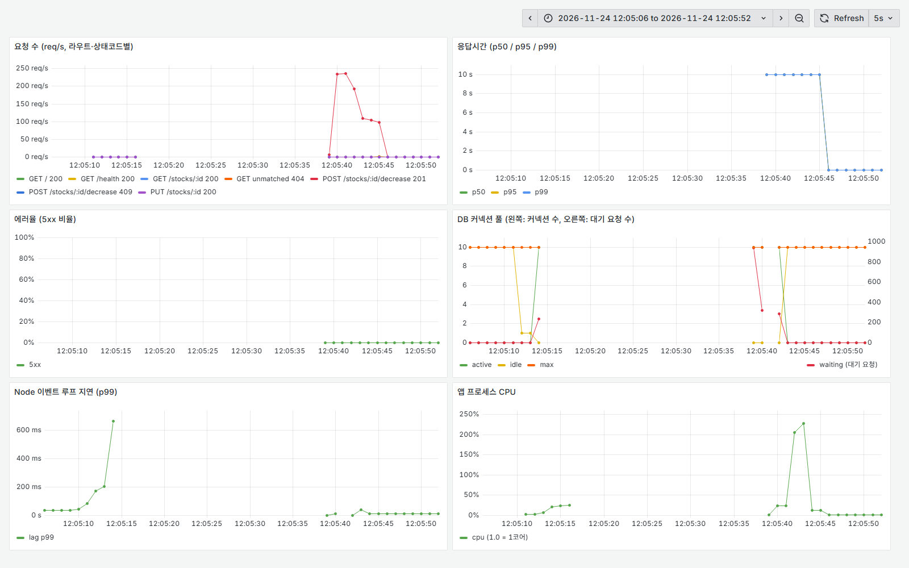
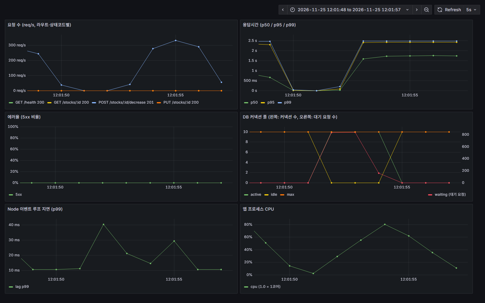

# 재고 차감 동시성 벤치마크

재고 100개에 차감 요청 1000건을 동시에 보내, 동시성 제어 전략별로 정합성(오버셀링)과 성능을 비교한다.

## 시나리오

- 스크립트: `k6/stock-decrease.js` (`pnpm k6:stock`)
- executor: `shared-iterations`, VU 1000명, 반복 1000회 (VU당 1건)
- 요청: `POST /stocks/1/decrease` `{ "quantity": 1 }`
- 초기 재고 100 (setup에서 `PUT /stocks/1`로 매 실행마다 초기화)
- 판정: `sold > 100`이면 오버셀링 (threshold `sold: count<=100`)
- 결과 JSON: `k6/results/<strategy>-<timestamp>.json`

## 전략 전환

엔드포인트는 그대로 두고, 앱 환경변수 `STOCK_STRATEGY`로 차감 전략을 고른다 (`src/stock/strategies/`, 기본값 `naive`).

| 값 | 전략 |
|---|---|
| `naive` | 조회 → JS에서 차감 → 저장 (락 없음) |
| `atomic-update` | `UPDATE ... SET quantity = quantity - n WHERE id = ? AND quantity >= n` 한 문장 |
| `pessimistic-lock` | 트랜잭션 + `SELECT ... FOR UPDATE`로 행을 잠근 뒤 확인·차감 |

```bash
STOCK_STRATEGY=atomic-update docker compose up -d --build --wait app
STOCK_STRATEGY=atomic-update pnpm k6:stock
```

- 환경변수는 컨테이너를 **재생성**해야 반영된다. `docker compose restart`로는 바뀌지 않는다.
- `--watch` 없이 띄우면 소스 동기화가 없으므로 `--build`로 현재 소스를 이미지에 넣는다.
- k6의 결과 파일 이름표(`STRATEGY`)도 같은 `STOCK_STRATEGY` 값을 따른다. 앱과 k6에 같은 값을 줘야 이름표가 실제 전략과 맞는다.
  - `docker compose run`은 의존 서비스(app)의 설정이 바뀌었으면 app을 재생성한다. 앱과 다른 값으로 k6를 돌리면 측정 직전에 앱이 재시작되어 워밍업이 무효가 된다.
- 적용된 전략은 앱 시작 로그로 확인한다: `docker compose logs app | grep "stock strategy"`
- 알 수 없는 값이면 앱이 시작되지 않는다.
- Git Bash에서는 `/scripts/...` 경로가 Windows 경로로 바뀌므로 `MSYS_NO_PATHCONV=1`을 붙인다.

## 모니터링

부하 테스트 중 병목을 보려면 Prometheus + Grafana를 함께 띄운다.

```bash
pnpm dev          # app, postgres, redis
pnpm monitoring   # prometheus(:9090), grafana(:3001)
pnpm k6:stock
```

- Grafana: http://localhost:3001 (로그인 없음, 홈이 `dips app` 대시보드)
- 앱 메트릭: http://localhost:3000/metrics (Prometheus가 1초마다 수집)

| 패널 | 메트릭 | 볼 것 |
|---|---|---|
| 요청 수 | `http_request_duration_seconds_count` | 라우트·상태코드별 req/s |
| 응답시간 | `http_request_duration_seconds_bucket` | p50/p95/p99 |
| 에러율 | 위 count 중 `status_code=~"5.."` 비율 | 409(재고 부족)는 정상 거절이라 제외 |
| DB 커넥션 풀 | `db_pool_connections{state}`, `db_pool_waiting_requests`, `db_pool_max_connections` | active가 max에 붙고 waiting이 쌓이면 풀이 병목 |
| 이벤트 루프 지연 / CPU | `nodejs_eventloop_lag_p99_seconds`, `process_cpu_seconds_total` | 앱 프로세스 자체가 포화인지 |

모니터링 컨테이너도 같은 Docker VM 자원을 쓰므로, 수치 비교용 측정은 기존처럼 모니터링 없이 돌리고 병목 관찰용 실행과 구분한다.

## 실행 환경

| 항목 | 값 |
|---|---|
| CPU | AMD Ryzen 5 4500U (6코어 6스레드) |
| 메모리 | 11.4 GB |
| OS | Windows 11 Home |
| Docker | Docker Desktop 29.9.3 (WSL2, 커널 6.6.87.2) |
| Docker VM 자원 | vCPU 4개, 메모리 5.8 GB |
| 컨테이너 자원 제한 | 없음 (app, postgres, redis, k6가 VM 자원을 공유) |
| 앱 | NestJS 12, Node 26.13.1, `pnpm start:dev` (watch 모드) |
| DB | PostgreSQL 18.4 (alpine), `max_connections` 100 |
| ORM / 드라이버 | Prisma 7.10.1 + `@prisma/adapter-pg` (pg 8.23.1) |
| DB 커넥션 풀 | **10** (`DATABASE_POOL_MAX`, 기본값 10). 이 문서의 결과는 모두 10에서 측정 |
| k6 | grafana/k6 1.3.0 (같은 Docker 네트워크에서 `http://app:3000`으로 호출) |

**주의**
- 부하 발생기(k6)와 앱, DB가 같은 VM에서 CPU를 나눠 쓴다. 절대 수치보다는 전략 간 상대 비교용으로 본다.
- 앱이 dev 모드(`start:dev`)로 실행된다. 프로덕션 빌드보다 느릴 수 있다.
- 커넥션 풀 크기는 대기 시간과 락 경합을 직접 바꾸므로 전략 비교 결과를 좌우한다. 전략끼리는 같은 값으로 비교하고, 값을 바꾼 결과에는 풀 크기를 함께 적는다.
  - 변경: `DATABASE_POOL_MAX=20 pnpm dev`
  - 확인: `curl -s localhost:3000/metrics | grep db_pool_max_connections`. pg-pool은 0이나 숫자가 아닌 값을 에러 없이 10으로 바꾸므로 측정 전에 실제 적용값을 확인한다.
  - 앱 인스턴스 수 × 풀 크기가 Postgres `max_connections`(100)를 넘으면 커넥션 획득이 실패한다.

## 측정 규칙

같은 조건에서도 TPS가 약 390인 회차와 30~50인 회차가 섞여 나온 적이 있다 ([느린 회차](#느린-회차-mon3)). 원인을 찾지 못했으므로, 전략 비교용 수치는 아래 규칙으로 측정해 편차를 줄이고 드러낸다.

1. **모니터링을 끈다.** 느린 회차는 모두 모니터링을 켠 상태에서 나왔다. 수집할 때마다 `/metrics`가 이벤트 루프를 수십~수백 ms 막는 것도 확인했다 (`processOpenFileDescriptors`가 `/proc/self/fd`를 동기로 읽는다).
   - `docker compose --profile monitoring stop prometheus grafana`
2. **노트북 전원을 연결하고 다른 무거운 작업을 하지 않는다.** CPU 클럭이 바뀌면 같은 작업에도 CPU 시간이 달라진다.
3. **전략마다 앱을 재시작하고, 워밍업 1회는 버린다.** 재시작 직후 첫 실행은 느리다 (규칙 전 naive 측정의 1회차 참고).
   - `docker compose restart app`, 헬스체크가 통과한 뒤 `pnpm k6:stock` 1회 (기록하지 않음)
   - 전략을 바꿀 때는 restart 대신 [전략 전환](#전략-전환)의 재생성 명령을 쓴다.
4. **5회 측정하고 중앙값을 대표값으로 쓴다.** 평균은 느린 회차 하나에 크게 끌려간다.
5. **회차마다 앱 CPU 사용량을 함께 기록한다.** 느린 회차를 구분하는 근거다.
   - 실행 전후로 `curl -s localhost:3000/metrics | grep ^process_cpu_seconds_total`을 찍고 차이를 적는다.
6. **이상치는 지우지 않고 표에 표기한다.** TPS가 중앙값의 절반 미만인 회차를 이상치로 본다. 중앙값 계산에는 포함한다.
7. 전략끼리는 같은 환경(앱 실행 방식, 풀 크기, 요청 수)으로 측정한다.

## 결과: naive (락 없음)

조회 → JS에서 차감 → 저장 (`src/stock/stock.service.ts`의 `decrease`)

| 회차 | 결과 파일 | 판매(sold) | 거절(rejected) | 오버셀링 | TPS | p95 (ms) | 실패율 | 앱 CPU(초) |
|---|---|---|---|---|---|---|---|---|
| 1 | `naive-1795570687061.json` | 1000 | 0 | 900 | 296.4 | 2996.9 | 0 | 3.6 |
| 2 | `naive-1795570695649.json` | 1000 | 0 | 900 | 403.2 | 2086.9 | 0 | 2.6 |
| 3 | `naive-1795570704138.json` | 1000 | 0 | 900 | 456.0 | 1885.7 | 0 | 2.3 |
| 4 | `naive-1795570712923.json` | 1000 | 0 | 900 | 363.4 | 2391.6 | 0 | 2.8 |
| 5 | `naive-1795570721452.json` | 1000 | 0 | 900 | 395.5 | 2127.4 | 0 | 2.5 |
| **중앙값** | | **1000** | **0** | **900** | **395.5** | **2127.4** | **0** | **2.6** |

- 측정일: 2026-11-25, 커밋 `5c24047` (`main`), [측정 규칙](#측정-규칙) 적용 (모니터링 끔, AC 전원, 앱 재시작 후 워밍업 1회 제외)
- 이상치(TPS < 197.8, 중앙값의 절반) 없음. 앱 CPU도 2.3~3.6초로, 느린 회차(약 25초)는 나오지 않았다.

<details>
<summary>원본 JSON</summary>

`naive-1795570687061.json`
```json
{
  "strategy": "naive",
  "initial": 100,
  "requests": 1000,
  "sold": 1000,
  "rejected": 0,
  "oversold": 900,
  "tps": 296.3992370857572,
  "p95_ms": 2996.8695569499996,
  "failed_rate": 0
}
```

`naive-1795570695649.json`
```json
{
  "strategy": "naive",
  "initial": 100,
  "requests": 1000,
  "sold": 1000,
  "rejected": 0,
  "oversold": 900,
  "tps": 403.2395836742375,
  "p95_ms": 2086.8908567500002,
  "failed_rate": 0
}
```

`naive-1795570704138.json`
```json
{
  "strategy": "naive",
  "initial": 100,
  "requests": 1000,
  "sold": 1000,
  "rejected": 0,
  "oversold": 900,
  "tps": 456.03514203527624,
  "p95_ms": 1885.6672417,
  "failed_rate": 0
}
```

`naive-1795570712923.json`
```json
{
  "strategy": "naive",
  "initial": 100,
  "requests": 1000,
  "sold": 1000,
  "rejected": 0,
  "oversold": 900,
  "tps": 363.4282762514415,
  "p95_ms": 2391.62691095,
  "failed_rate": 0
}
```

`naive-1795570721452.json`
```json
{
  "strategy": "naive",
  "initial": 100,
  "requests": 1000,
  "sold": 1000,
  "rejected": 0,
  "oversold": 900,
  "tps": 395.47773702146395,
  "p95_ms": 2127.3993864500003,
  "failed_rate": 0
}
```

</details>

<details>
<summary>규칙 전 측정 (2026-11-24, 커밋 7fbb52e, 3회 평균)</summary>

| 회차 | 결과 파일 | 판매(sold) | 거절(rejected) | 오버셀링 | TPS | p95 (ms) | 실패율 |
|---|---|---|---|---|---|---|---|
| 1 | `naive-1795485730558.json` | 1000 | 0 | 900 | 204.5 | 3336.9 | 0 |
| 2 | `naive-1795485795635.json` | 1000 | 0 | 900 | 300.7 | 2712.5 | 0 |
| 3 | `naive-1795485830638.json` | 1000 | 0 | 900 | 304.9 | 2607.0 | 0 |
| **평균** | | **1000** | **0** | **900** | **270.0** | **2885.5** | **0** |

- 앱 재시작 직후 워밍업 없이 측정했고, 1회차 TPS가 2·3회차보다 낮았다.

</details>

### 해석

- 5회 모두 1000건이 전부 판매되어 **오버셀링 900건**이 났다. 409(재고 부족)는 한 건도 없었다.
- 여러 요청이 같은 재고 값을 읽고 덮어써서(lost update) 재고가 0까지 내려가지 않는다. 그래서 거절이 생기지 않는다.
  - 최종 재고만 보면 오버셀링을 놓친다. 판매 건수(`sold`)로 판정해야 한다.
- p95 약 2.1초의 대부분은 커넥션 풀(10개) 대기 시간이다 (아래 관찰에서 메트릭으로 확인). 요청 1000건이 커넥션 10개를 기다리며 줄을 선다.
- 워밍업을 제외해도 TPS가 296~456으로 회차 간 편차가 있다. 전략 간 차이가 이 범위 안이면 우열을 말하기 어렵다.

## 결과: atomic-update (원자적 UPDATE)

재고 확인과 차감을 UPDATE 한 문장으로 처리 (`src/stock/strategies/atomic-update.strategy.ts`)

| 회차 | 결과 파일 | 판매(sold) | 거절(rejected) | 오버셀링 | TPS | p95 (ms) | 실패율 | 앱 CPU(초) |
|---|---|---|---|---|---|---|---|---|
| 1 | `atomic-update-1795574016348.json` | 100 | 900 | 0 | 601.4 | 1383.0 | 0 | 2.0 |
| 2 | `atomic-update-1795574020985.json` | 100 | 900 | 0 | 544.8 | 1422.8 | 0 | 2.1 |
| 3 | `atomic-update-1795574025692.json` | 100 | 900 | 0 | 562.7 | 1505.5 | 0 | 1.9 |
| 4 | `atomic-update-1795574030662.json` | 100 | 900 | 0 | 516.2 | 1668.5 | 0 | 2.2 |
| 5 | `atomic-update-1795574035053.json` | 100 | 900 | 0 | 572.6 | 1473.3 | 0 | 1.9 |
| **중앙값** | | **100** | **900** | **0** | **562.7** | **1473.3** | **0** | **2.0** |

- 측정일: 2026-11-25, 커밋 `5a5d75b` (`feat/atomic-update-strategy`), [측정 규칙](#측정-규칙) 적용 (모니터링 끔, AC 전원, 앱 재시작 후 워밍업 1회 제외)
- 이상치(TPS < 281.4, 중앙값의 절반) 없음. 앱 CPU 1.9~2.2초.

<details>
<summary>원본 JSON</summary>

`atomic-update-1795574016348.json`
```json
{
  "strategy": "atomic-update",
  "initial": 100,
  "requests": 1000,
  "sold": 100,
  "rejected": 900,
  "oversold": 0,
  "tps": 601.4350940015981,
  "p95_ms": 1382.97381295,
  "failed_rate": 0
}
```

`atomic-update-1795574020985.json`
```json
{
  "strategy": "atomic-update",
  "initial": 100,
  "requests": 1000,
  "sold": 100,
  "rejected": 900,
  "oversold": 0,
  "tps": 544.8426092002729,
  "p95_ms": 1422.8311306999997,
  "failed_rate": 0
}
```

`atomic-update-1795574025692.json`
```json
{
  "strategy": "atomic-update",
  "initial": 100,
  "requests": 1000,
  "sold": 100,
  "rejected": 900,
  "oversold": 0,
  "tps": 562.7052991956134,
  "p95_ms": 1505.4896237,
  "failed_rate": 0
}
```

`atomic-update-1795574030662.json`
```json
{
  "strategy": "atomic-update",
  "initial": 100,
  "requests": 1000,
  "sold": 100,
  "rejected": 900,
  "oversold": 0,
  "tps": 516.1932836480435,
  "p95_ms": 1668.5175511,
  "failed_rate": 0
}
```

`atomic-update-1795574035053.json`
```json
{
  "strategy": "atomic-update",
  "initial": 100,
  "requests": 1000,
  "sold": 100,
  "rejected": 900,
  "oversold": 0,
  "tps": 572.5918148032075,
  "p95_ms": 1473.28274205,
  "failed_rate": 0
}
```

</details>

### 해석

- 5회 모두 정확히 100건 판매, 900건 거절(409), 최종 재고 0으로 **오버셀링이 없다.**
- naive 대비 (중앙값): TPS 395.5 → 562.7 (약 1.4배), p95 2127.4 → 1473.3ms (약 31% 감소), 앱 CPU 2.6 → 2.0초.
  - TPS 범위가 naive 296~456, atomic-update 516~601로 겹치지 않으므로 회차 간 편차보다 큰 차이다.
  - 다만 두 전략은 따로 측정했고 커밋도 다르다(`5c24047` / `5a5d75b`).
- 거절 경로에서는 갱신된 행이 없을 때 404/409를 구분하려고 `SELECT`가 하나 더 나간다. 이 시나리오에서는 1000건 중 900건이 거절이므로, 쿼리 수는 판매 100건 × 1 + 거절 900건 × 2 = 1900개다 (naive는 1000건 × 2 = 2000개).
- 쿼리 수는 거의 같으므로 쿼리 수로는 속도 차이가 설명되지 않는다. 차이는 **같은 행에 대한 쓰기 횟수**다 ([관찰](#관찰-naive-vs-atomic-update-대기-지점)에서 확인).
  - naive는 lost update로 1000건이 모두 같은 행을 UPDATE하고, 각 UPDATE는 커밋(WAL flush)까지 행 락을 쥔다. 관찰 실행에서 DB에서 실행 중인 커넥션의 대부분(7.8개 중 5.9개)이 이 행 락을 기다리고 있었다.
  - atomic-update는 판매 100건만 행을 바꾼다 (WAL 레코드 4039 → 299). 재고가 0이 된 뒤의 UPDATE는 조건에 맞는 행이 없어 락 대기 없이 끝나고, 뒤따르는 `SELECT`는 읽기라 가볍다.

## 관찰: naive 실행 중 DB 커넥션 풀

모니터링을 켠 상태로 naive 시나리오를 다시 돌려 커넥션 풀 상태를 확인했다.

- 측정일: 2026-11-24, 브랜치 `feat/metrics`
- 수집 간격 1초. 메트릭은 1초 단위 샘플이라 순간 최댓값은 놓칠 수 있다.

| 회차 | 모니터링 | TPS | p95 (ms) | waiting 최대 | 앱 CPU 사용량(초) |
|---|---|---|---|---|---|
| mon1 | 켬 | 49.3 | 19568.0 | 727 | 약 25 |
| mon2 | 켬 | 353.9 | 2436.1 | 832 | 약 3.0 |
| nomon1 | 끔 | 393.8 | 2256.8 | - | 약 3.7 (nomon1·2 평균) |
| nomon2 | 끔 | 382.4 | 2240.8 | - | 약 3.7 (nomon1·2 평균) |
| mon3 | 켬 (직전 재시작) | 29.0 | 26184.4 | 937 | 약 25.6 |

- 모든 회차에서 오버셀링 900건으로 정합성 결과는 이전과 같다.
- 앱 CPU 사용량은 `process_cpu_seconds_total`의 회차 전후 차이다. 요청 1000건을 처리하는 데 쓴 CPU 시간이다.

### 일반적인 회차 (mon2)


- 부하가 들어오자마자 `active`가 `max`(10)에 붙고, `waiting`이 **832**까지 치솟는다.
  - 요청 1000건 중 10건만 DB 커넥션을 잡고, 나머지 800여 건은 풀 앞에서 줄을 선다.
- 앱 CPU는 1코어의 약 95%까지 오르지만 짧게 끝나고, 이벤트 루프 지연도 한 번 튀었다가(약 350ms) 바로 내려온다.
- 응답시간 p50 약 1.7초, p95 약 2.4초.
  - 요청 하나의 DB 작업(SELECT + UPDATE)은 짧으므로, 대부분은 커넥션을 기다린 시간이다.
- **결론: 이 시나리오의 1차 병목은 DB 커넥션 풀(10개)이다.** 앞에서 "p95의 대부분은 커넥션 풀 대기로 보인다"고 추정한 것을 메트릭으로 확인했다.
  - 단, 풀을 키우는 것은 지연을 줄일 뿐 오버셀링을 막지 못한다. 정합성 문제는 락/원자적 갱신으로 해결해야 한다.

### 느린 회차 (mon3)



5회 중 2회(mon1, mon3)는 TPS가 30~50으로 평소의 약 1/8이었다. 이때의 관찰:

- 풀은 똑같이 포화된다 (`active` 10, `waiting` 최대 937). 차이는 대기가 **약 30초** 지속된다는 점이다.
- 12:05:14~12:05:38 구간이 비어 있는 것은 Prometheus가 `/metrics` 수집에 실패했기 때문이다 (`up` = 0).
  - 수집 타임아웃은 수집 간격과 같은 1초다. 앱이 1초 안에 `/metrics`에 응답하지 못할 만큼 이벤트 루프가 막혀 있었다 (직전 이벤트 루프 지연 p99 약 660ms).
- 같은 요청 1000건에 앱 CPU를 약 25초 썼다. 빠른 회차(약 3초)의 **7~8배**다.
  - VM의 다른 컨테이너가 CPU를 빼앗아 느려진 것이 아니라, 앱 프로세스가 요청당 더 많은 일을 했다.
- 응답시간 그래프가 10초에서 평평한 것은 히스토그램 최대 버킷이 10초라서다. 실제 p95는 26초였다.
- CPU 그래프의 200%대 값은 수집 공백 직후 `rate()`가 계산한 값이라 실제 순간값과 다르다. 공백 구간 평균은 약 1코어다.

**원인은 아직 모른다.** 확인한 사실과 배제된 것:

- 모니터링을 켜기만 한다고 느려지지는 않는다 (mon2는 모니터링을 켜고도 빨랐다).
- 느린 두 회차 모두 모니터링이 켜져 있었다. mon3는 Prometheus·Grafana를 재시작한 직후였다. 모니터링을 끈 2회는 모두 빨랐지만 표본이 적어 관련 여부를 단정할 수 없다.
- 다음 단계: 느린 회차를 재현해서 앱 CPU 프로파일(`node --cpu-prof`)을 떠 본다. 원인을 찾기 전까지 전략 비교용 수치 측정은 모니터링을 끄고 한다.

## 관찰: naive vs atomic-update 대기 지점

atomic-update가 naive보다 빠른 이유를 확인하려고, 모니터링을 켜고 두 전략을 1회씩 같은 절차로 돌려 앱 커넥션 풀과 DB 쪽 대기를 함께 봤다.

- 측정일: 2026-11-25, 커밋 `26e6b3f` (`feat/atomic-update-strategy`)
- 절차: 전략별로 앱 재생성 → 워밍업 1회 → 측정 1회. 모니터링을 켠 관찰용 실행이라 TPS는 [결과](#결과-atomic-update-원자적-update) 표와 비교하지 않는다.
- DB 대기: 측정 중 100ms마다 `pg_stat_activity`에서 실행 중인(`state='active'`) 앱 커넥션을 대기 이벤트별로 셌다.
  ```sql
  select coalesce(wait_event_type,'CPU'), coalesce(wait_event,'-'), count(*)
  from pg_stat_activity
  where datname='dips' and backend_type='client backend' and state='active' and pid<>pg_backend_pid()
  group by 1, 2
  ```
  - `psql`의 `\watch i=0.1 c=150`으로 돌렸다. postgres 컨테이너의 PID 1은 postmaster라서, `docker compose exec`로 띄운 프로세스를 시그널로 죽이면 postmaster가 크래시로 보고 서버 전체를 재시작한다. 그래서 샘플러가 정해진 횟수 뒤 스스로 끝나게 했다.
- WAL: 측정 전후 `pg_stat_wal`의 차이. 샘플러 쿼리, setup/teardown 요청도 포함된다.

| | naive | atomic-update |
|---|---|---|
| 결과 파일 | `naive-1795575713891.json` | `atomic-update-1795575754547.json` |
| 판매 / 거절 | 1000 / 0 | 100 / 900 |
| TPS / p95 (ms) | 362.0 / 2368.3 | 386.6 / 1922.8 |
| 풀 `waiting` 최대 | 839 | 828 |
| WAL 레코드 / 바이트 | 4039 / 213,473 | 299 / 16,123 |
| DB 실행 중 커넥션이 보인 샘플 (150개 중) | 14 | 6 |
| 그 샘플의 평균 실행 중 커넥션 | 7.8 | 2.8 |
| └ 행 락 대기 (`Lock/transactionid`, `Lock/tuple`) | 5.9 | 1.8 |
| └ WAL flush 대기 (`IO/WalSync`) | 0.5 | 0.5 |
| 앱 CPU (초) | 3.0 | 3.1 |

### naive



### atomic-update


- 두 스크린샷 모두 왼쪽 끝 1~2초는 직전 워밍업 실행의 꼬리다.

### 해석

- **쓰기 횟수가 차이를 만든다.** WAL 레코드가 4039 → 299로 약 13분의 1이다. naive는 lost update로 1000건이 모두 같은 행에 UPDATE를 하고, atomic-update는 판매 100건만 행을 바꾼다. 재고가 0이 된 뒤 들어온 UPDATE는 스냅샷에서 WHERE(`quantity >= 1`)가 맞지 않아 행 락을 기다리지 않고, 바뀐 행이 없으니 WAL도 남기지 않는다.
- **naive의 DB 쪽 대기는 대부분 행 락이다.** DB에서 실행 중인 커넥션이 보일 때 평균 7.8개 중 5.9개가 다른 트랜잭션의 행 락을 기다리고 있었다. 락을 쥔 쪽은 커밋(WAL flush)까지 락을 놓지 않으므로, 같은 행에 대한 쓰기 1000번이 직렬로 줄을 선다.
- **atomic-update의 행 락 대기는 판매 구간에만 있다.** 행 락 대기는 측정 초반 약 0.7초(판매 100건 구간)에만 보였고, 그 뒤 거절 900건 동안은 DB에서 실행 중인 커넥션이 거의 보이지 않았다.
- **병목이 행 락으로 옮겨가지는 않았다.** 행 락 대기는 naive에서 더 컸고 atomic-update에서 줄었다. 반대로 풀 `waiting` 최댓값은 839 → 828로 거의 같다.
  - 요청 1000건이 한꺼번에 도착하고 커넥션은 10개라, `waiting` 최댓값은 주로 도착 패턴이 정한다. 전략 차이는 최댓값보다 대기 시간(p95)에 나타난다.
  - atomic-update의 거절 구간에서는 풀의 `active`가 10인데도 DB에서 실행 중인 커넥션은 거의 없었다. 커넥션을 잡고 있는 시간의 대부분이 DB 밖(네트워크 왕복, 앱의 요청·응답 처리)이라는 뜻이다. 남은 병목은 DB보다 앱 쪽으로 보인다. 앱 CPU는 1코어의 약 90%까지 올랐다.
- 한계: 전략별 1회씩, 100ms 간격 샘플이다. 1ms 미만으로 끝나는 쿼리는 샘플에 잘 잡히지 않으므로, 샘플 수 자체보다 대기 이벤트의 비율을 본다.

## 결과: 세 전략 재측정 + pessimistic-lock (같은 커밋)

앞의 naive·atomic-update 결과는 서로 다른 커밋에서 따로 측정했다. 이번에는 세 전략을 같은 커밋·같은 세션에서 naive → atomic-update → pessimistic-lock 순으로 연달아 측정했다.

- 측정일: 2026-11-25, 커밋 `56832ff` (`feat/atomic-update-strategy`), [측정 규칙](#측정-규칙) 적용 (모니터링 끔, AC 전원, 전략마다 앱 재생성 후 워밍업 1회 제외, 5회 중앙값)
- 앱 재생성: `docker compose up -d --build --force-recreate --wait app`. 설정이 같으면 `up -d`는 컨테이너를 다시 만들지 않으므로 `--force-recreate`를 붙였다. 배치마다 컨테이너 ID가 바뀐 것과 `db_pool_max_connections`, 시작 로그의 전략 이름을 확인했다.
  - 처음 돌린 naive 배치는 `--force-recreate` 없이 돌려 앱이 재시작되지 않았으므로 버렸다 (`naive-1795581710341` ~ `naive-1795581742667`).
- 실패율은 k6 `http_req_failed`(201·409·200 외 응답 비율, setup/teardown 요청 2건 포함)다. 워밍업을 포함한 모든 회차에서 `unexpected`(201·409 외 응답)가 0건이었다.

### naive

| 회차 | 결과 파일 | 판매 | 거절 | 오버셀링 | TPS | p95 (ms) | 실패율 | 앱 CPU(초) |
|---|---|---|---|---|---|---|---|---|
| 1 | `naive-1795581813460.json` | 889 | 111 | 789 | 353.1 | 2054.0 | 0 | 3.14 |
| 2 | `naive-1795581819592.json` | 1000 | 0 | 900 | 376.8 | 2329.3 | 0 | 2.52 |
| 3 | `naive-1795581826271.json` | 1000 | 0 | 900 | 415.3 | 2141.7 | 0 | 2.32 |
| 4 | `naive-1795581836189.json` | 1000 | 0 | 900 | 210.5 | 4142.8 | 0 | 4.03 |
| 5 | `naive-1795581842506.json` | 1000 | 0 | 900 | 397.9 | 2245.1 | 0 | 2.45 |
| **중앙값** | | **1000** | **0** | **900** | **376.8** | **2245.1** | **0** | **2.52** |

- 이상치(TPS < 188.4) 없음. 4회차는 TPS 210.5로 가장 낮고 앱 CPU도 4.03초로 가장 많았다.
- 1회차는 재고가 0까지 내려가 111건이 거절됐다(최종 재고 0). 나머지 회차는 최종 재고 93~96으로 거절이 없었다. 오버셀링은 모든 회차에서 났다.

### atomic-update

| 회차 | 결과 파일 | 판매 | 거절 | 오버셀링 | TPS | p95 (ms) | 실패율 | 앱 CPU(초) |
|---|---|---|---|---|---|---|---|---|
| 1 | `atomic-update-1795581872741.json` | 100 | 900 | 0 | 502.7 | 1645.4 | 0 | 2.34 |
| 2 | `atomic-update-1795581878464.json` | 100 | 900 | 0 | 505.6 | 1582.5 | 0 | 2.22 |
| 3 | `atomic-update-1795581884076.json` | 100 | 900 | 0 | 526.1 | 1589.5 | 0 | 2.09 |
| 4 | `atomic-update-1795581889743.json` | 100 | 900 | 0 | 569.3 | 1461.4 | 0 | 2.03 |
| 5 | `atomic-update-1795581895306.json` | 100 | 900 | 0 | 551.1 | 1542.6 | 0 | 2.07 |
| **중앙값** | | **100** | **900** | **0** | **526.1** | **1582.5** | **0** | **2.09** |

- 이상치(TPS < 263.1) 없음.

### pessimistic-lock

트랜잭션 + `SELECT ... FOR UPDATE`로 행을 잠근 뒤 확인·차감 (`src/stock/strategies/pessimistic-lock.strategy.ts`)

| 회차 | 결과 파일 | 판매 | 거절 | 오버셀링 | TPS | p95 (ms) | 실패율 | 앱 CPU(초) |
|---|---|---|---|---|---|---|---|---|
| 1 | `pessimistic-lock-1795581927063.json` | 100 | 900 | 0 | 443.3 | 1932.6 | 0 | 2.56 |
| 2 | `pessimistic-lock-1795581933117.json` | 100 | 900 | 0 | 450.6 | 1910.3 | 0 | 2.43 |
| 3 | `pessimistic-lock-1795581939326.json` | 100 | 900 | 0 | 412.8 | 2115.0 | 0 | 2.60 |
| 4 | `pessimistic-lock-1795581946119.json` | 100 | 900 | 0 | 366.0 | 2404.4 | 0 | 2.81 |
| 5 | `pessimistic-lock-1795581952861.json` | 100 | 900 | 0 | 418.5 | 1935.2 | 0 | 2.53 |
| **중앙값** | | **100** | **900** | **0** | **418.5** | **1935.2** | **0** | **2.56** |

- 이상치(TPS < 209.3) 없음. 모든 회차 최종 재고 0.

### pessimistic-lock: 커넥션 풀 크기별

`DATABASE_POOL_MAX`만 바꾸고 같은 절차로 측정했다. 풀 10은 위 표와 같은 측정이다.

| 풀 | TPS 중앙값 (범위) | p95 중앙값 (ms) | 실패율 | 앱 CPU 중앙값(초) | 결과 파일 |
|---|---|---|---|---|---|
| 10 | 418.5 (366.0~450.6) | 1935.2 | 0 (5회 모두) | 2.56 | `pessimistic-lock-1795581927063` ~ `1795581952861` |
| 20 | 449.1 (408.0~487.0) | 1959.1 | 0 (5회 모두) | 2.22 | `pessimistic-lock-1795581984343` ~ `1795582008205` |
| 50 | 389.9 (364.9~432.0) | 2099.2 | 0 (5회 모두) | 2.81 | `pessimistic-lock-1795582041473` ~ `1795582068757` |

- 이상치 없음. 모든 회차 판매 100 / 거절 900 / 최종 재고 0.

## 관찰: 세 전략 대기 지점 (같은 커밋)

[이전 관찰](#관찰-naive-vs-atomic-update-대기-지점)과 같은 절차(앱 재생성 → 워밍업 1회 → 측정 1회, 모니터링 켬, `pg_stat_activity` 100ms × 150샘플, `pg_stat_wal` 전후 차이)로 전략별 1회씩 돌렸다. 풀 크기 비교를 위해 pessimistic-lock은 풀 50에서도 1회 돌렸다.

- 측정일: 2026-11-25, 커밋 `56832ff`. 모니터링을 켠 관찰용 실행이라 TPS는 위 결과 표와 비교하지 않는다.
- 풀 `waiting` 최대: Prometheus `max_over_time(db_pool_waiting_requests[...])` (1초 수집이라 순간 최댓값은 놓칠 수 있다)
- 대기 이벤트별 값은 "DB에서 실행 중인 커넥션이 보인 샘플"당 평균이다.

| | naive | atomic-update | pessimistic-lock | pessimistic-lock (풀 50) |
|---|---|---|---|---|
| 결과 파일 | `naive-1795582118886.json` | `atomic-update-1795582175387.json` | `pessimistic-lock-1795582227852.json` | `pessimistic-lock-1795582291531.json` |
| 판매 / 거절 | 1000 / 0 | 100 / 900 | 100 / 900 | 100 / 900 |
| TPS / p95 (ms) | 348.9 / 2513.1 | 479.6 / 1659.3 | 377.0 / 2302.2 | 402.4 / 2131.6 |
| 실패율 | 0 | 0 | 0 | 0 |
| 풀 `waiting` 최대 | 847 | 486 | 672 | 901 |
| WAL 레코드 / 바이트 | 4021 / 212,162 | 316 / 58,936 | 2834 / 127,429 | 2491 / 113,134 |
| DB 실행 중 커넥션이 보인 샘플 (150개 중) | 18 | 4 | 24 | 21 |
| 그 샘플의 평균 실행 중 커넥션 | 7.94 | 2.50 | 7.83 | 46.05 |
| └ `Lock/tuple` | 0.50 | - | 6.58 | 44.43 |
| └ `Lock/transactionid` | 5.83 | 1.50 | 1.17 | 1.29 |
| └ `IO/WalSync` | 0.83 | 0.25 | - | - |
| └ `LWLock/LockManager` | 0.50 | - | - | - |
| └ CPU (대기 이벤트 없음) | 0.28 | 0.75 | 0.08 | 0.24 |
| └ `Client/ClientRead` | - | - | - | 0.10 |
| 앱 CPU (초) | 2.86 | 2.40 | 3.01 | 2.62 |

### 해석

- **pessimistic-lock은 정합성이 맞고 실패가 없다.** 풀 10·20·50의 측정 15회, 관찰 2회, 워밍업 5회(측정 배치 3회·관찰 2회) 모두 판매 100 / 거절 900 / 최종 재고 0, 실패율 0이었다. `maxWait`·`timeout` 30초 설정에서 풀 대기로 인한 트랜잭션 시간 초과는 나오지 않았다.
- **같은 커밋에서 TPS 중앙값은 atomic-update 526.1 > pessimistic-lock 418.5 > naive 376.8이다.**
  - atomic-update(503~569)는 pessimistic-lock(366~451)과 범위가 겹치지 않는다.
  - pessimistic-lock과 naive(211~415)는 범위가 겹치므로 둘의 속도 차이는 회차 간 편차와 구분되지 않는다.
- **풀을 키워도 pessimistic-lock의 TPS는 나아지지 않았다.** 풀 10/20/50의 TPS 범위가 서로 겹치고 중앙값에 일정한 방향이 없다(418.5 → 449.1 → 389.9).
- **늘어난 커넥션은 행 락 대기로 쌓인다.** 풀 50 관찰에서 DB 실행 중 커넥션은 평균 46.05개였고, 그중 44.43개가 `Lock/tuple`(같은 행의 `FOR UPDATE` 락) 대기였다. 풀 10에서는 7.83개 중 6.58개였다. 커넥션 수와 무관하게 같은 행에 대한 락을 한 번에 하나씩만 잡으므로, 처리량의 천장은 풀이 아니라 행 락 직렬화로 보인다. "행 락이 천장이면 풀을 키워도 효과가 작다"는 가설과 맞는 결과다.
  - 한계: 관찰은 풀 크기별 1회씩, 100ms 간격 샘플이다. 풀 20은 관찰하지 않았다.
- **pessimistic-lock은 거절 요청도 행을 잠근다.** atomic-update는 재고가 0이 된 뒤의 UPDATE가 행을 건드리지 않지만(WAL 316레코드), pessimistic-lock은 900건의 거절 요청도 `FOR UPDATE`로 행을 잠근 뒤 재고를 확인한다. WAL 레코드가 2834개로 atomic-update보다 훨씬 많은 것도 이와 맞는다(Postgres는 `FOR UPDATE` 락을 행에 기록한다). 다만 레코드 종류별 내역(`pg_waldump`)은 확인하지 않았다.
